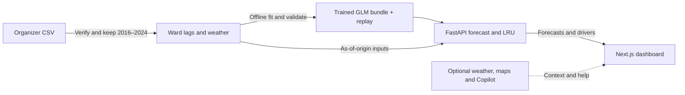

# DengueShield AI: Architecture

DengueShield forecasts weekly dengue counts and statistical outbreak risk for 60 synthetic wards. FastAPI serves both the compiled dashboard and API locally. In production, Vercel serves the static Next.js dashboard and proxies `/api/*` to FastAPI on Hugging Face Spaces.

## Weather and chronological validation

The loader verifies the organizer file's SHA-256 and filters to 2016–2024 before CSV parsing. Temperature, humidity and rainfall are loaded onto a regular weekly panel. The 24-feature F8 pipeline groups shifts and rolling windows by ward. Under the primary start-of-week convention, features for a Monday origin use observations through the prior week. Rainfall unavailable at issue time is represented by a climatology estimated from prior data when the feature requires it.

Each expanding outer fold fits on earlier seasons and predicts a later full season. Outer folds span 2019–2024. Hyperparameter search used 2019–2021, and 2022–2024 is the comparison window. Interval dispersion and the alert probability threshold use the two preceding validation seasons. The 2025 holdout stays sealed and is excluded from fit, selection, calibration and scoring. See the [validation protocol](docs/validation_protocol.md) and [holdout protocol](docs/holdout_protocol.md).

## Model and inference

The predeclared selection rule favors the simplest eligible candidate within 0.05 average MAE of the leader on both benchmark windows. A ridge Poisson GLM uses one model per horizon. On 2022–2024 its median-forecast MAE was **1.107 / 1.393 / 1.512 cases per ward-week** at 2 / 3 / 4 weeks. Negative-binomial intervals quantify uncertainty, and coefficient contributions explain the log case rate. Training quantiles define Low, Medium, High and Critical tiers. Peak counts tend to be underpredicted, and intervals cover fewer weeks during peaks.

FastAPI loads the roughly 11 KB serialized bundle once and caches all-ward predictions by model checksum, origin and horizon. Historical Replay serves saved out-of-time predictions for the evidence and decision tools. Bundle results inside the training period are labeled in-sample. The organizer data are synthetic. Real weather and healthcare geography provide context without feeding the model.

## Compute and API controls

- Inference runs on CPU, with bounded in-memory caches and no online fitting. The dashboard loads charts and maps on demand. The OSM road graph is built offline and routes locally.
- Weather uses per-city memory and disk caches with stale fallbacks. Historical queries cache for 24 hours, current Open-Meteo queries for 10 minutes, and forecasts for one hour.
- Copilot keeps its key on the backend. It uses read-only tools, up to 900 output tokens and 30 requests per hour per client, a one-hour answer cache, and a configurable in-process budget guard. Retrieval-only and keyword fallbacks handle missing generation access or a stale embedding index.

## Subsystem reference

[ML pipeline](docs/architecture/ml-pipeline.md) · [Backend API](docs/architecture/backend.md) · [Frontend](docs/architecture/frontend.md) · [Geospatial routing](docs/architecture/geospatial.md) · [Copilot](docs/architecture/copilot.md) · [Decision support](docs/architecture/decision-support.md) · [Deployment and security](docs/architecture/deployment-security.md)
