# DengueShield AI: Architecture

DengueShield forecasts weekly dengue counts and statistical outbreak risk for 60 synthetic wards. FastAPI serves both the compiled dashboard and API locally. In production, Vercel serves the static Next.js dashboard and proxies `/api/*` to FastAPI on Hugging Face Spaces.

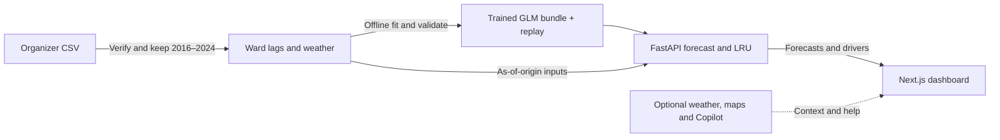

## Weather and chronological validation

The loader verifies the organizer file's SHA-256 and filters to 2016–2024 before CSV parsing. Temperature, humidity and rainfall are loaded onto a regular weekly panel. The 24-feature F8 pipeline groups shifts and rolling windows by ward. Under the primary start-of-week convention, features for a Monday origin use observations through the prior week. Rainfall unavailable at issue time is represented by a climatology estimated from prior data when the feature requires it.

Each expanding outer fold fits on earlier seasons and predicts a later full season. Outer folds span 2019–2024. Hyperparameter search used 2019–2021, and 2022–2024 is the comparison window. Interval dispersion and the alert probability threshold use the two preceding validation seasons. The 2025 holdout stays sealed and is excluded from fit, selection, calibration and scoring. See the [validation protocol](docs/validation_protocol.md) and [holdout protocol](docs/holdout_protocol.md).

## Model and inference

The predeclared selection rule favors the simplest eligible candidate within 0.05 average MAE of the leader on both benchmark windows. A ridge Poisson GLM uses one model per horizon. On 2022–2024 its median-forecast MAE was **1.107 / 1.393 / 1.512 cases per ward-week** at 2 / 3 / 4 weeks. Negative-binomial intervals quantify uncertainty, and coefficient contributions explain the log case rate. Training quantiles define Low, Medium, High and Critical tiers. Peak counts tend to be underpredicted, and intervals cover fewer weeks during peaks.

FastAPI loads the roughly 11 KB serialized bundle once and caches all-ward predictions by model checksum, origin and horizon. Historical Replay serves saved out-of-time predictions for the evidence and decision tools. Bundle results inside the training period are labeled in-sample. The organizer data are synthetic. Real weather and healthcare geography provide context without feeding the model.

## Compute and API controls

- Inference runs on CPU, with bounded in-memory caches and no online fitting. The dashboard loads charts and maps on demand. The OSM road graph is built offline and routes locally.
- Weather uses per-city memory and disk caches with stale fallbacks. Historical queries cache for 24 hours, current Open-Meteo queries for 10 minutes, and forecasts for one hour.
- Copilot keeps its key on the backend. It uses read-only tools, up to 900 output tokens and 30 requests per hour per client, a one-hour answer cache, and a configurable in-process budget guard. Retrieval-only and keyword fallbacks handle missing generation access or a stale embedding index.

## Subsystem reference

[ML pipeline](#ml-pipeline-from-raw-data-to-a-calibrated-forecast-bundle) · [Backend](#backend-fastapi-service) · [Frontend](#frontend-nextjs-static-dashboard) · [Geospatial](#geospatial-facilities-road-graphs-a-routing-and-emergency-help) · [Copilot](#copilot-grounded-retrieval-and-read-only-tools) · [Decision support](#decision-support-reliability-alert-policy-time-machine-resource-planning) · [Launch, deployment and security](#launch-deployment-and-security)

## ML pipeline: from raw data to a calibrated forecast bundle

Details: [`model_selection.md`](docs/model_selection.md), [`calibration_and_uncertainty.md`](docs/calibration_and_uncertainty.md), [`validation_protocol.md`](docs/validation_protocol.md)

### Stages

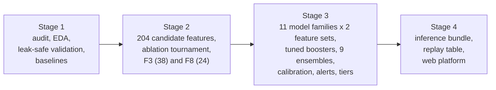

### Forecast for one ward, origin and horizon

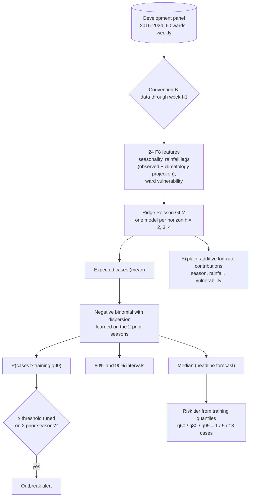

### Validation that every reported number comes from

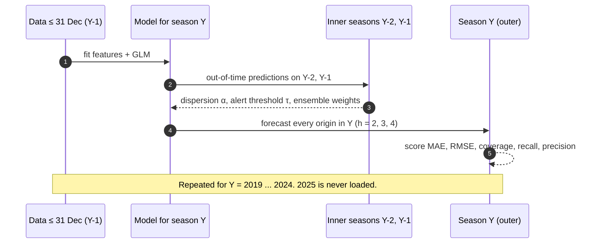

### Artifacts

| Artifact | Produced by | Used by |
|---|---|---|
| `models/dengueshield_B.joblib` (primary), `_A.joblib` | Stage 3 notebooks | `/api/forecast*` live inference, `explain` |
| `app_data/replay.csv.gz` (53,100 rows) | `python -m dengueshield.appdata` from Stage 3 out-of-time predictions | Historical Replay, reliability center, alert simulator, resource sandbox |
| `reports/model_tournament/*.csv`, `app_data/validation.json` | notebooks 07-08 | Model Evidence |
| `app_data/{profile,distributions,correlations,seasonality,lag_analysis}.json` | `dengueshield.appdata` | Data Profiling Studio, Forecast Lab |

### Results (unchanged since Stage 3)

| Horizon | MAE 2022-24 | Coverage 80 / 90 (all weeks) | Coverage 80 / 90 (peaks) | Alert recall / precision (pooled replay) |
|---|---|---|---|---|
| 2 weeks | 1.107 | season means: 0.854 / 0.911 | season means: 0.607 / 0.740 | per horizon in the Reliability center |
| 3 weeks | 1.393 | | | 0.758 / 0.508 |
| 4 weeks | 1.512 | | | |

### Data flow

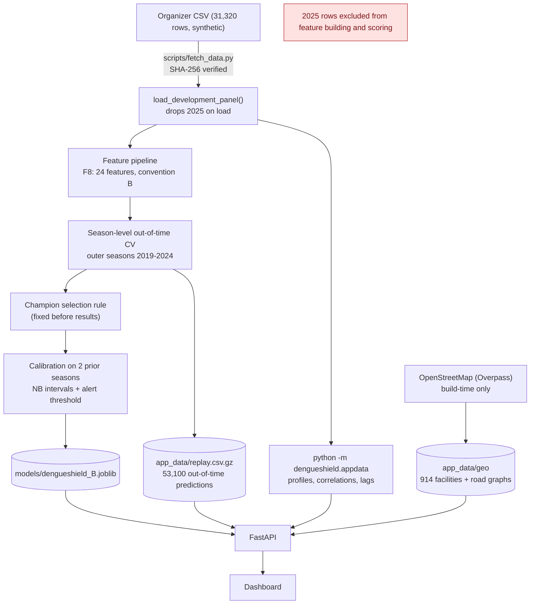

#### Integrity boundaries

| Boundary | Rule |
|---|---|
| Organizer data vs real weather | NASA POWER / Open-Meteo are shown **beside** the synthetic data in the Climate Observatory; never a model input. |
| Live bundle vs Historical Replay | Replay = out-of-time predictions (2019-2024, nested calibration), used for every accuracy claim. Bundle values for origins ≤ 2024 are in-sample and labelled. |
| LLM vs numbers | The Copilot quotes only numbers returned by its read-only tools; it never computes forecasts. |
| Real facilities vs synthetic wards | Hospitals and roads are real OSM records; forecasts appear on the map only as city-level aggregates. No facility, route or polygon is linked to a synthetic ward ID. |
| Official boundaries vs dataset wards | DGHS polygons are context only; with no verified crosswalk, predictions use an abstract matrix. |
| Decision tools vs model | Reliability, alert-policy and allocation tools read saved replay rows only; nothing is refitted and the deployed alert rule is unchanged. |
| Frontend vs secrets | `OPENAI_API_KEY` stays in the backend `.env`; only public map keys are in `frontend/.env.local`. |

### Chronological validation

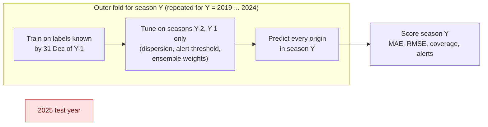

- **Origin convention B (primary):** a forecast issued at the start of week *t* uses weather and cases through week *t-1*; convention A is labelled "assumes week *t* is complete".
- **Hyperparameter search** ran on 2019-2021 only; 2022-2024 is the benchmark window.
- **Locked holdout:** 2025 is dropped on load, never displayed or scored (`docs/holdout_protocol.md`). The API refuses origins later than the last data week + 1.

### Why this model

Rule fixed before the tuned and ensemble results were seen (`docs/model_selection.md` §7): shortlist everything within 0.05 MAE of the best,
then take the simplest. Winner: **ridge Poisson GLM, 24 features, one model per horizon.**

| | |
|---|---|
| MAE 2022-24 (h = 2/3/4) | 1.107 / 1.393 / 1.512 |
| Cost | ~0.4 s to fit, sub-millisecond to predict, 11 KB bundle |
| Why not boosting/ensembles | Gaps to the best candidate were 0.002-0.037 MAE, inside the noise of 3-6 seasons; the GLM has the best high-incidence behaviour of the shortlist, the lowest variability and additive per-driver explanations |
| Intervals | Negative binomial, dispersion calibrated on the two prior seasons. 80% / 90% coverage 0.854 / 0.911 on average |
| Alert | P(cases ≥ training q90) ≥ tuned cut. Recall ≈ 0.78, precision ≈ 0.53 (season means; pooled 3-week replay 0.758 / 0.508) |
| Known weakness | Intervals under-cover outbreak peaks (0.607 at 80%, 0.740 at 90%) and peaks are under-predicted by ≈ 3 cases; shown in the UI |

Risk tiers (Low/Medium/High/Critical) are quantiles of the training data (1 / 5 / 13 weekly cases): **statistical categories, not official warning levels.**

## Backend: FastAPI service

Interactive reference: `/docs` (OpenAPI) on a running server

### Modules

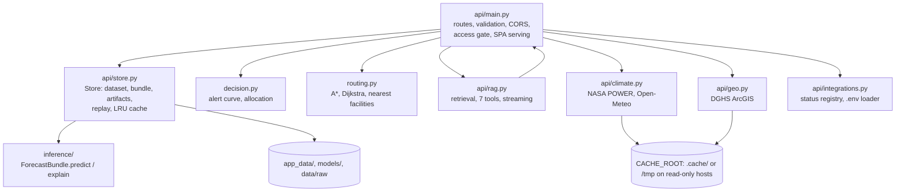

### Request lifecycle

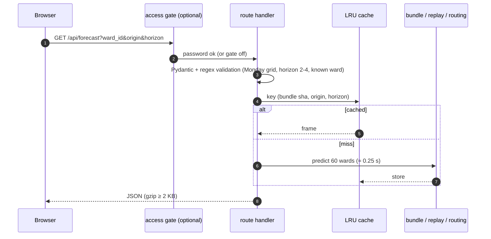

### Endpoint groups

| Group | Endpoints | Source |
|---|---|---|
| Health and metadata | `/api/health`, `/api/metadata`, `/api/cities`, `/api/wards`, `/api/integrations/status` | Store |
| Forecasts | `/api/forecast`, `/api/forecast/compare`, `/api/forecast/series`, `/api/risk/wards`, `/api/reports/summary` | bundle (live) or replay |
| Model evidence | `/api/model/{metrics,features,validation,calibration,diagnostics}` | committed artifacts |
| Data profile | `/api/data/{profile,distributions,correlations,seasonality,lag-analysis}`, `/api/weather/historical` | `app_data/` |
| Decision support | `/api/decision/{alert-curve,allocate,allocation-season}` | replay + pre-origin panel |
| Geospatial | `/api/facilities`, `/api/route`, `/api/emergency/{nearest,info}`, `/api/routing/status`, `/api/geo/dghs/{status,filters,wards}` | `app_data/geo`, DGHS |
| Climate | `/api/climate/{observations,current,compare}` | NASA POWER, Open-Meteo |
| Copilot | `/api/assistant/chat` (SSE), `/api/assistant/status` | OpenAI (optional) |
| Documents | `/api/docs`, `/api/docs/read` | allow-listed Markdown only |

### Failure handling

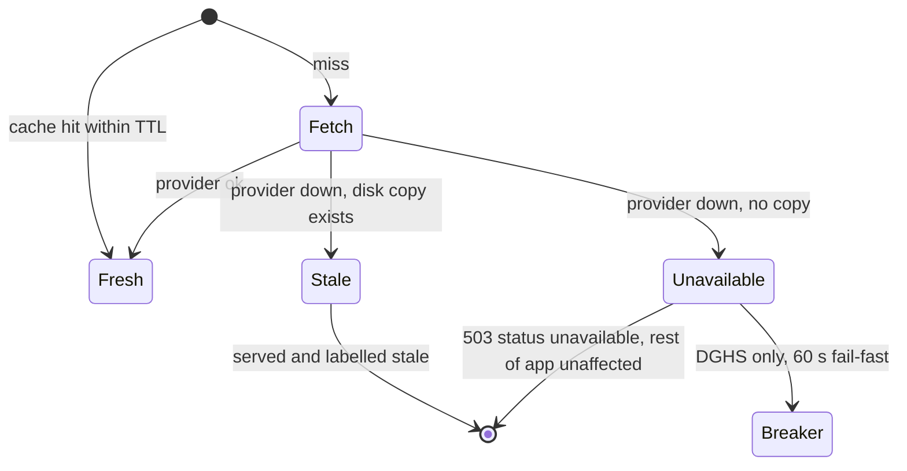

### System context

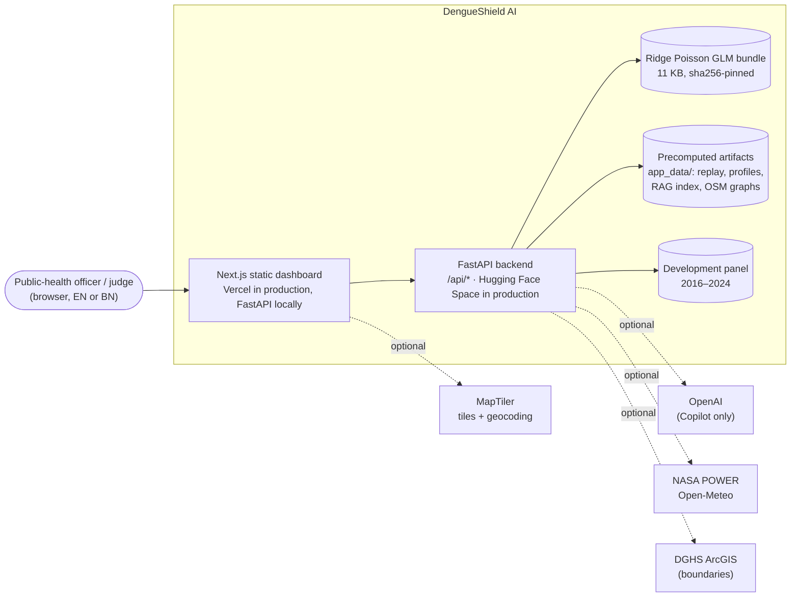

Solid lines are required; dotted lines are optional services with timeouts, caches and graceful fallbacks.

## Frontend: Next.js static dashboard

Next.js 16 (static export), React 19, TypeScript, Tailwind 4, ECharts 6 (tree-shaken), MapLibre 6 with MapTiler, React Three Fiber (intro and Learn
page only), Motion. The build output `frontend/out` is served by FastAPI on the same origin, so there is no CORS and no server rendering.

### Application shell

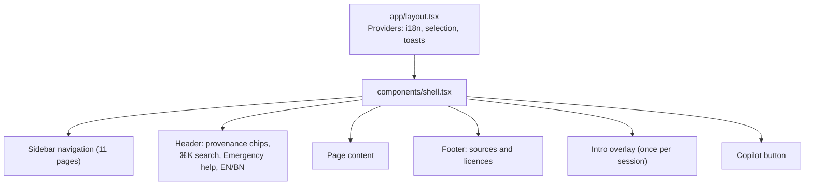

### Pages

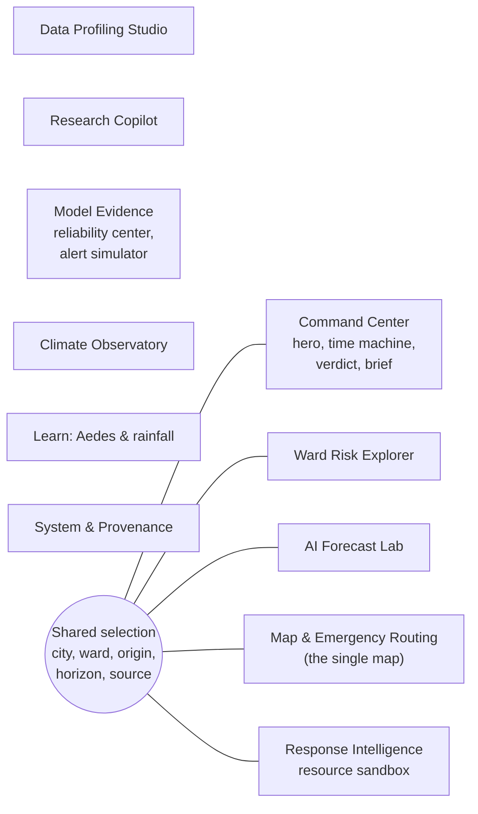

### Data access in the browser

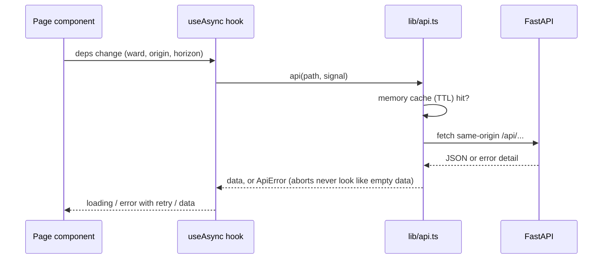

### Cross-cutting rules

| Concern | Implementation |
|---|---|
| Bilingual | `lib/i18n.tsx` EN/BN dictionary, Bengali digits and dates, Noto Sans Bengali |
| Design system | tokens in `app/globals.css` (midnight navy, forest, teal, restrained cyan, ivory), atoms in `components/ui.tsx` |
| Charts | `components/echart.tsx` lazy ECharts, shared axis style, accessible labels |
| Performance | code-split map, charts and 3D; Command Center LCP 220 ms cold / 88 ms warm (local) |
| Accessibility | keyboard-reachable controls, ARIA roles on tabs, switches, dialogs; reduced-motion respected everywhere |
| Safety | Copilot Markdown sanitised; no secrets in the bundle (tested) |

## Geospatial: facilities, road graphs, A* routing and emergency help

Details: [`geospatial_routing.md`](docs/geospatial_routing.md), [`dghs_gis_integration.md`](docs/dghs_gis_integration.md)

### Build-time data pipeline

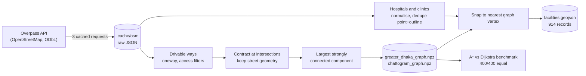

### Routing request

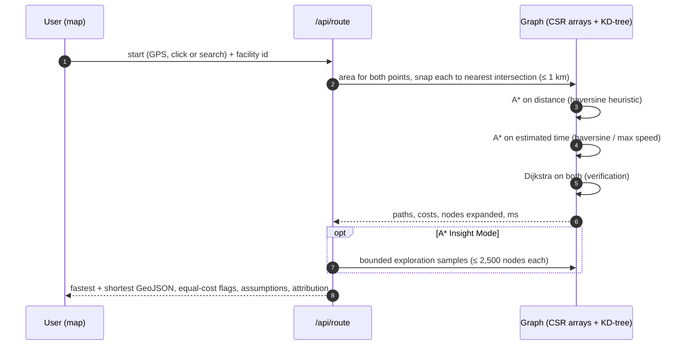

### Map composition (one map)

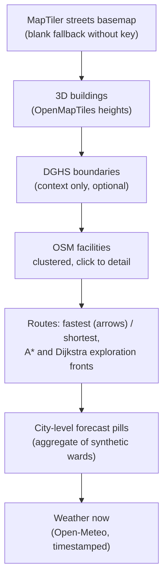

Synthetic ward forecasts are never attached to real geometry: the map shows them only as city aggregates, and the abstract ward-risk matrix sits beside the map.

### Emergency flow

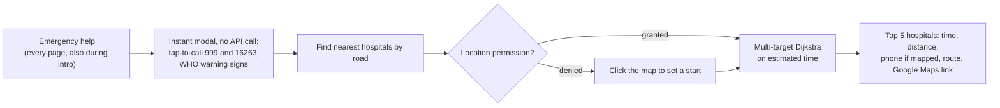

No beds, admissions, doctors on duty or live traffic exist in these sources, and none are shown.

## Copilot: grounded retrieval and read-only tools

### Components

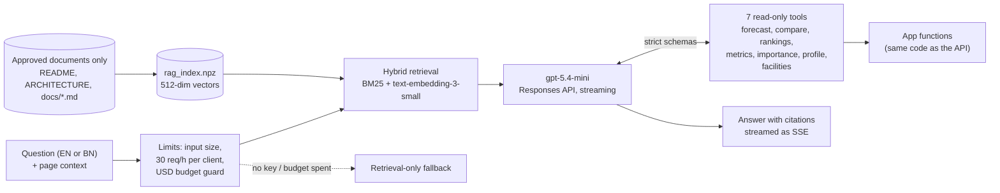

### One answer

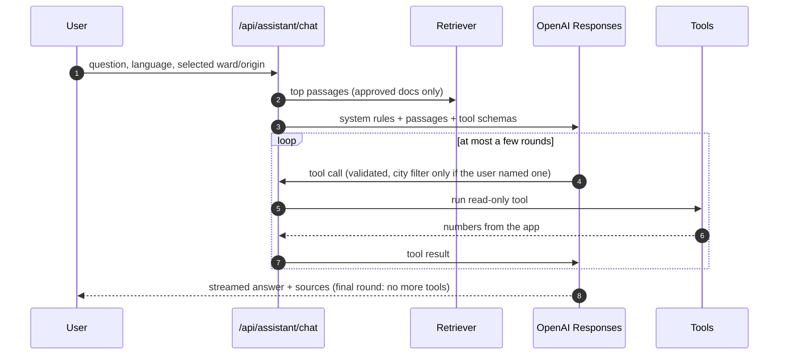

| Guard | Behaviour |
|---|---|
| Secrets | Key only in the backend `.env`; the model is told never to reveal configuration, and secret scans run in tests |
| Holdout | Tools cannot read 2025; requests for 2025 actuals are refused |
| Cost | 900 output tokens, 1 h cache for identical questions, usage log without message content, ≈ $0.002-0.004 per answer |
| Prompt injection | Retrieval is limited to an allow-list of project documents; tool outputs are data, not instructions |

## Decision support: reliability, alert policy, time machine, resource planning

Evidence and numbers: [`decision_support.md`](docs/decision_support.md)

### Inputs and outputs

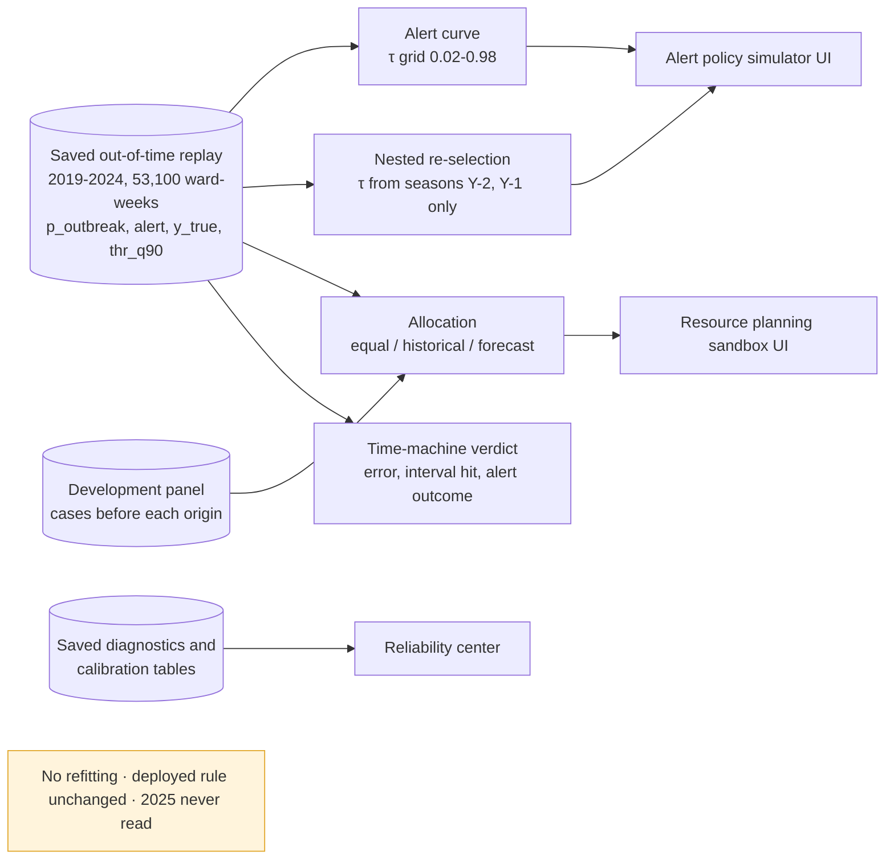

### Why the simulator cannot leak

```mermaid
flowchart TB
    subgraph honest["Reported as honest estimates"]
        dep["Deployed rule<br/>τ per season from 2 prior seasons<br/>(Stage 3)"]
        nes["Nested F1 re-selection<br/>τ for 2021-2024 from 2 prior replay seasons"]
    end
    subgraph optimistic["Labelled optimistic"]
        sel["Any τ picked on the slider"]
        best["Best in-sample τ"]
    end
    eval["Scored on the same replay rows"]
    dep --> eval
    nes --> eval
    sel --> eval
    best --> eval
```

### Resource sandbox rules

| Rule | Ranking key (available at the origin) | Tie-break |
|---|---|---|
| Equal (risk-blind) | round-robin across cities | ward ID |
| Historical risk | mean weekly cases strictly before the origin | ward ID |
| Forecast | calibrated P(outbreak) at the origin | expected cases, then ward ID |

Outcome = retrospective coverage of actual outbreak wards and cases in the target week. It is a planning simulation, not a claim about prevented infections or real capacity.

## Launch, deployment and security

Steps: [`deployment.md`](docs/deployment.md)

### Local launch (judges)

```mermaid
flowchart LR
    clone["git clone"] --> sh["./scripts/launch.sh"]
    sh --> venv["Python venv<br/>pip install -r requirements.txt"]
    sh --> data["scripts/fetch_data.py<br/>download + SHA-256 check"]
    sh --> fe["npm ci && npm run build<br/>(static export)"]
    venv & data & fe --> run["uvicorn on one port<br/>API + dashboard"]
```

An authenticated GitHub clone and cold-cache launch reached a healthy server in about 101 seconds with a verified 2016–2024 fixture already in place. See the [fresh-clone measurement](README.md#fresh-clone-measurement) for the setup and what the timing covers.

### Deployment targets

```mermaid
flowchart TB
    repo[("GitHub repository")]
    subgraph vercel["Vercel: static dashboard (vercel.json, .vercelignore)"]
        cdn["frontend/out on the CDN<br/>rewrite /api/* to the Space"]
    end
    subgraph space["Hugging Face Space: API (scripts/deploy_space.py, Dockerfile.backend)"]
        img["Python 3.12 image: FastAPI, model bundle, app_data,<br/>dataset fetched and checksum-verified at build"]
    end
    repo --> vercel
    repo --> space
    cdn -->|"same-origin /api proxy"| img
    secrets["Space secrets: OPENAI_API_KEY, ACCESS_PASSWORD,<br/>OPENAI_BUDGET_USD"] -.-> space
    pub["Vercel env (public): NEXT_PUBLIC_MAPTILER_KEY"] -.-> vercel
```

Single-container alternative: the root `Dockerfile` bundles dashboard and API (used for local or one-host runs).

### Security model

```mermaid
flowchart LR
    b["Browser"] -->|"HTTP Basic (optional ACCESS_PASSWORD)"| gate["Access gate<br/>(all routes except /api/health)"]
    gate --> api["API: validated inputs,<br/>allow-listed documents,<br/>read-only tools"]
    api --> sec[("Backend-only secrets<br/>.env, platform env")]
    b -.->|"public keys only"| tiles["MapTiler (domain-restricted key)"]
```

| Control | Where |
|---|---|
| Secrets never in git or the browser bundle | `.gitignore`, `.dockerignore`, `.vercelignore`; Playwright secret scan of served assets |
| Input validation | Pydantic types, regex patterns, bounded numbers (horizon 2-4, teams 1-60, simplify ≤ 0.01) |
| Injection-safe external queries | DGHS filter values quoted and validated; facility IDs pattern-checked |
| Bounded compute | routing snap ≤ 1 km, insight samples ≤ 2,500, DGHS ≤ 3,000 features, Copilot rate and budget limits |
| Data licences | OSM ODbL (`app_data/geo/LICENSE.md`), Open-Meteo CC BY 4.0, NASA POWER acknowledgement, MapTiler/OSM attribution on the map |
| Organizer data | not committed; fetched and checksum-verified; served only as derived views |

### Compute and API cost controls

| Resource | Control |
|---|---|
| Model inference | No GPU. ≈ 0.25 s for a cold 60-ward origin, ≈ 6 ms warm (LRU). Replay lookups ≈ 4 ms |
| Dashboard | Static export, no server rendering. Charts, map and 3D are code-split and loaded on demand; the 3D intro and Learn model fall back to SVG without WebGL or on low-end devices and are skipped or still under reduced motion. Command Center LCP 220 ms cold, 88 ms warm (local) |
| OpenAI | Backend only. `gpt-5.4-mini` answers, `text-embedding-3-small` (512 dims) retrieval index built once into `app_data/rag_index.npz` (≈ $0.0008 per rebuild). 900 output tokens, 30 requests/hour per client, input-size limit, USD budget guard (`OPENAI_BUDGET_USD`, default 1.00), 1 h response cache, usage log without content; ≈ $0.002-0.004 per answer. Without a key: retrieval-only |
| NASA POWER / Open-Meteo | Per-city queries, 15-40 s timeouts, memory + disk cache (history 24 h, current 10 min), stale fallback |
| Decision tools | Saved replay only: alert curve 15 ms, allocation 8 ms, season allocation 375 ms, cached per query |
| Routing | Local and free: graphs load in ≈ 0.3 s; A* median 6.5 ms (400/400 equal to Dijkstra). OSM is queried only by the offline build script; MapTiler geocoding runs from the browser only when the user searches places |
| DGHS GIS | 6 s connect timeout, 60 s circuit breaker, pagination capped at 3,000 features, 7-day cache with stale fallback |
| Deployment access | Optional shared password (`ACCESS_PASSWORD`, HTTP Basic); per-client Copilot rate limit works behind a proxy |
| Map tiles | MapTiler key in `frontend/.env.local`; without it the map uses a blank basemap and facilities, routes and directory still work |

If any external service fails, its panel shows a status message and every other page keeps working (`/api/integrations/status`).

### Testing

```mermaid
flowchart LR
    py["pytest<br/>leakage, alignment, models, bundle,<br/>API contracts, A* vs Dijkstra,<br/>decision tools without look-ahead"] --> gate{{"release gate"}}
    pw["Playwright<br/>all routes, console errors, mobile 390 px,<br/>Bangla, map routing, emergency, intro,<br/>reliability, simulator, sandbox, brief,<br/>search, secret scan"] --> gate
    build["next build + typecheck"] --> gate
    clone["fresh-clone launch smoke test"] --> gate
```

## Climate Futures 2026–2030: exploratory scenario engine

A separate seasonal model with its own metrics, labelled "Exploratory multi-year climate scenario". It never touches the 2–4-week champion bundle
or the 2025 holdout. Backtest, calibration and model card: [climate_futures.md](docs/climate_futures.md).

```mermaid
flowchart LR
    dev[("Development rows 2016–2024<br/>(2025 never parsed)")] --> fit["Seasonal Poisson GLM<br/>ward + harmonics + lagged weather"]
    dev --> clim["Climatology reference"]
    wx[("Whole historical weather years")] -->|"resample per draw<br/>× rain, + °C (bounded)"| mc
    fit --> mc["Monte Carlo (seeded)<br/>year bootstrap + year shock + NB counts"]
    mc --> api["/api/scenarios/run · compare · backtest<br/>cached, bounded"]
    clim --> api
    api --> ui["Forecast Lab: Climate Futures section"]
```

Rolling-origin backtest 2019–2024: without future weather the engine matches climatology (ward-week MAE 1.421 vs 1.431, annual error 20.6% vs 19.5%).
With the true weather it would reach 1.098 and 8.2%, which is why outputs are conditional scenarios, not forecasts. Its bands are labelled simulation ranges.
