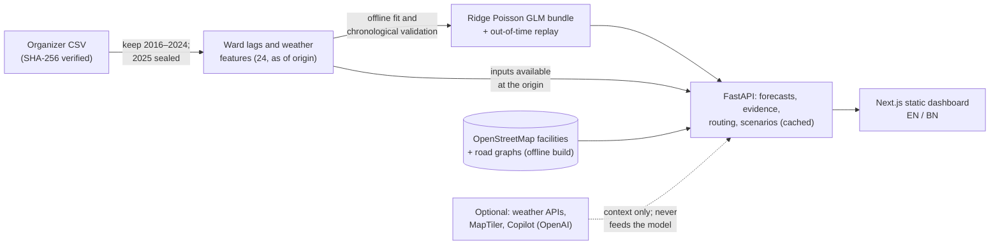
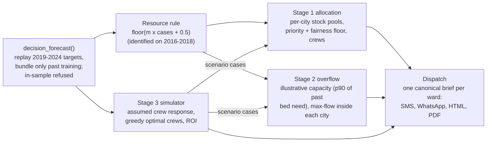

# DengueShield AI: Architecture

DengueShield forecasts weekly dengue counts and outbreak risk 2–4 weeks ahead for 60 synthetic wards in five city corporations, explains each
forecast, shows how reliable it is, and helps users reach real hospitals over the OpenStreetMap road network. The organizer data are synthetic:
this is a historical replay and research tool, not live surveillance. Full technical reference with all diagrams:
[docs/architecture/COMPLETE_ARCHITECTURE.md](docs/architecture/COMPLETE_ARCHITECTURE.md).

## System data flow

## Chronological validation

- The loader verifies the file checksum and parses only 2016–2024 rows; **2025 is a sealed holdout**, never read in development.
- Features for an origin week use only information available before it (start-of-week convention B). Rainfall not yet observed for the target
  window is replaced by a past-year climatology projection, never by future weather.
- Expanding outer folds predict each season 2019–2024 with models fitted on earlier seasons only (the replay table). Interval dispersion and the
  alert threshold are learned on the two preceding seasons.
- **Honest labelling:** 2022–2024 were also used to choose features, the model, the interval method and the alert rule, so their scores are
  *validation used for model selection*, not a blind test. The only blind test is 2025, evaluated once after a model is frozen.

## Model selection

A rule fixed before the tuned and ensemble results were seen: keep every candidate within 0.05 MAE of the best on both windows, then pick the
simplest (plain Poisson GLM, then other GLMs, then ensembles, then boosting). Eleven base model variants (count GLMs, gradient-boosted trees,
a hurdle model), three tuned boosters and nine ensembles were compared on identical folds; tuned LightGBM, XGBoost and CatBoost gained on their
tuning seasons but not on 2022–2024. The winner is a **ridge Poisson GLM, one per horizon, 24 features**: simplest, fastest (sub-millisecond
prediction, 11 KB bundle) and additively explainable. Five classical benchmarks added in V3 (Random Forest, Extra Trees, ridge least squares,
k-NN, MLP) and five baselines, run on the same folds, all trail it: full comparison in [`reports/MODEL_COMPARISON.md`](reports/MODEL_COMPARISON.md).

| Horizon | MAE, 2022–2024 (validation used for selection) | MAE, 2019–2024 out-of-time (pooled) | 80% coverage: all / peak weeks |
|---|---|---|---|
| 2 weeks | 1.106 | 1.112 | 0.89 / 0.64 |
| 3 weeks | 1.392 | 1.390 | 0.85 / 0.56 |
| 4 weeks | 1.511 | 1.592 | 0.83 / 0.52 |

Source of every figure: `app_data/metrics_canonical.json` (built by `scripts/build_canonical_metrics.py`, served at `/api/model/canonical-metrics`).

## API and inference

FastAPI loads the bundle once and caches all-ward predictions by model checksum, origin and horizon; heavy calls run at most four at a time.
The validated replay serves out-of-time predictions for the evidence and decision tools; bundle results inside the training period are labelled
in-sample on display pages and refused by the decision tools (Phase 2). Routing uses a custom A\* on directed OSM road graphs, each route checked against Dijkstra; emergency search lists general hospitals
only (veterinary, diagnostic-only and specialist facilities are classified and left out). The static frontend is served by Vercel and proxies
`/api` to a Hugging Face Space; locally one command serves both.

## Phase 2 onsite: operational engines

The onsite final adds four engines behind the same forecasts, all pure Python on local files, exposed on the Response Intelligence page
and fully usable offline.

| Engine | Module, endpoint | Guarantees (tested) |
|---|---|---|
| Allocation | `dengueshield/allocation.py`, `/api/allocation/plan` | integers, exact conservation, no ward above demand, deterministic ties, optimum checked against an LP solver |
| Overflow | `dengueshield/overflow.py`, `/api/overflow/plan` | transfers only inside a city, no duplicated patients, maximum flow, checked against brute force and Edmonds-Karp; capacity uses only weeks before the forecast date |
| Simulator | `dengueshield/intervention.py`, `/api/intervention/simulate` | zero crews or zero effect reproduce the forecast exactly, bounded reductions, crew optimum checked against brute force and dynamic programming |
| Dispatch | `dengueshield/dispatch.py`, `dengueshield/pdfmini.py`, `/api/dispatch/brief`, `/api/dispatch/document` | numbers copied from the engines, scenario id and content hash, byte-identical outputs, nothing sent |
| Offline | `dengueshield/offline.py`, `scripts/launch_offline.sh`, `/api/system/offline` | artifact and dependency check before start; outbound connections refused and recorded; kill-switch test in CI (network namespace) with results identical to the online run |

The dashboard sections share one plan state (city, service level, stock, crews, capacity, intervention settings), so all four sections and
every brief describe the same scenario. Assumptions that are not in the data (stock, crews, ward capacity, intervention effect) are user
settings and are labelled as such everywhere. Details and evidence: [`docs/onsite/`](docs/onsite/) (Stage 0 to Stage 4 handoffs and
[`FINAL_RELEASE.md`](docs/onsite/FINAL_RELEASE.md)).

## Hospital preparedness engine (upgrade branch)

`dengueshield/preparedness.py` runs a deterministic daily model (28 days) for fictional planning hospitals
(`app_data/preparedness/planning_hospitals.json`, provenance `synthetic_demo`) driven by the origin-safe forecast: mixed-patient
occupancy with admitted and unresolved demand kept apart, saline and kit inventory with conservation and dynamic reorder points,
rule-based alerts, and three states (baseline, crisis, response) where the response opens surge beds, places orders and solves an LP
referral plan checked by `scipy` max-flow. `/api/preparedness/plan|brief|referrals|contacts`. The official ward-level overflow engine
is unchanged. Real facilities (OSM) are searched by road time; their capacity and availability are reported as unknown.
Details: [`docs/upgrade/HOSPITAL_PREPAREDNESS.md`](docs/upgrade/HOSPITAL_PREPAREDNESS.md).

## Compute and cost controls

- CPU-only inference, bounded in-memory caches, no online fitting; charts, maps and 3D load only on the pages that use them.
- Weather: per-city memory and disk caches with stale fallbacks (history 24 h, current conditions 10 min).
- Copilot (optional, backend-only key): read-only tools; 900 output tokens per round; 20 questions per client and 120 per service per hour; at
  most 3 concurrent provider calls; a monthly budget ledger that **reserves each answer's worst-case cost before calling the provider** and
  charges cancelled or failed answers in full; retrieval-only fallback at no cost. These are application limits; a provider-side hard limit is
  still recommended.

## Known limitations

- Outbreak-peak weeks are under-predicted 77% of the time (by about 3.7 cases); 80% intervals cover 57% of peak weeks (pooled), because the
  deployed dispersion collapses to Poisson. A magnitude-dependent calibration passed a pre-registered test (`research/v3/`) and awaits a decision.
- 4-week skill is limited by missing information: at that horizon every rainfall input is a climatology projection.
- Six validation seasons only; synthetic data; ward identifiers are synthetic and never mapped onto real ward boundaries.

## Detailed reference

[ML pipeline](docs/architecture/COMPLETE_ARCHITECTURE.md#ml-pipeline-from-raw-data-to-a-calibrated-forecast-bundle) ·
[Backend](docs/architecture/COMPLETE_ARCHITECTURE.md#backend-fastapi-service) ·
[Frontend](docs/architecture/COMPLETE_ARCHITECTURE.md#frontend-nextjs-static-dashboard) ·
[Geospatial](docs/architecture/COMPLETE_ARCHITECTURE.md#geospatial-facilities-road-graphs-a-routing-and-emergency-help) ·
[Copilot](docs/architecture/COMPLETE_ARCHITECTURE.md#copilot-grounded-retrieval-and-read-only-tools) ·
[Decision support](docs/architecture/COMPLETE_ARCHITECTURE.md#decision-support-reliability-alert-policy-time-machine-resource-planning) ·
[Deployment and security](docs/architecture/COMPLETE_ARCHITECTURE.md#launch-deployment-and-security) ·
[Climate Futures](docs/architecture/COMPLETE_ARCHITECTURE.md#climate-futures-20262030-exploratory-scenario-engine)
