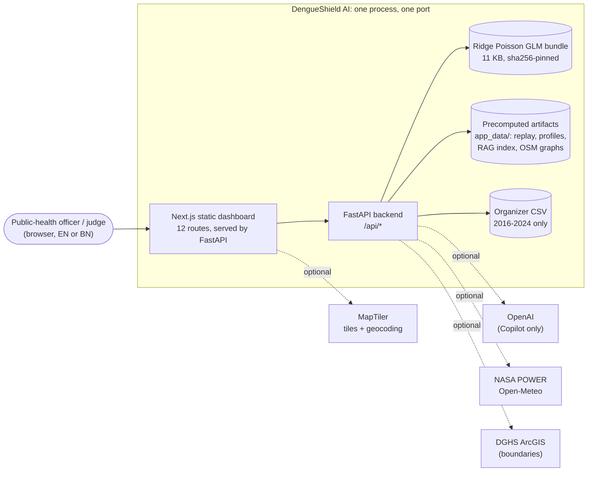
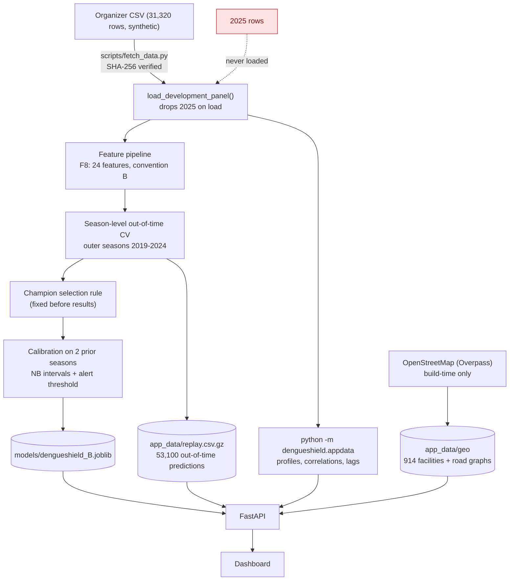
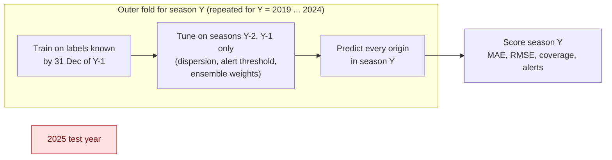
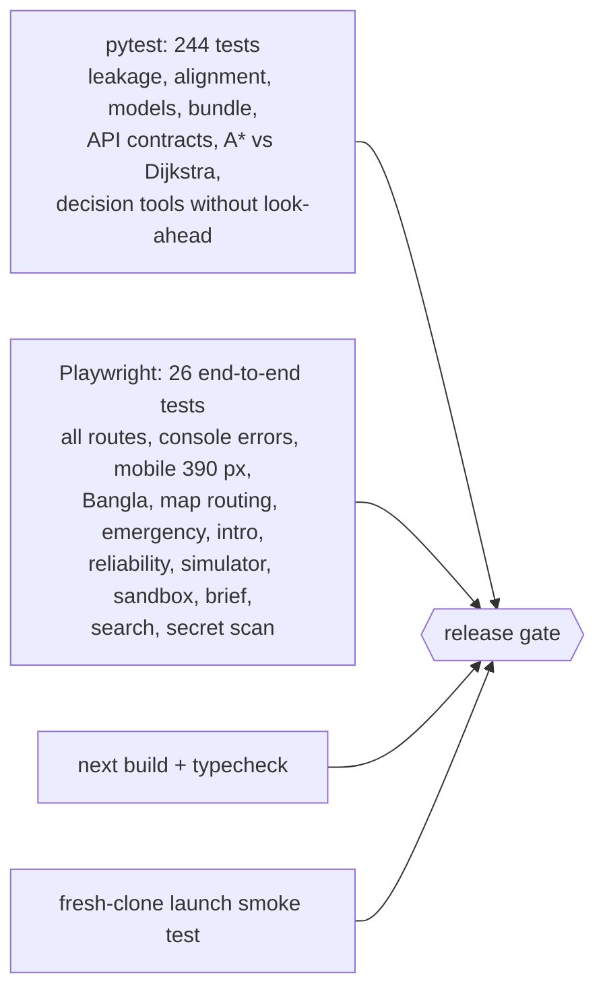

# DengueShield AI: Architecture

One Python process serves the forecasting API **and** the pre-built dashboard on a single port. Forecasts come from a small statistical
model fitted offline. Every external service (OpenAI, weather, maps, DGHS) is optional, sits beside the model and never feeds it.

| Subsystem | Detailed architecture |
|---|---|
| Forecasting model, validation, calibration | [docs/architecture/ml-pipeline.md](docs/architecture/ml-pipeline.md) |
| Backend API, caching, data loading | [docs/architecture/backend.md](docs/architecture/backend.md) |
| Frontend, pages, shared state | [docs/architecture/frontend.md](docs/architecture/frontend.md) |
| Facilities, road graphs, A* routing, emergency help | [docs/architecture/geospatial.md](docs/architecture/geospatial.md) |
| Copilot (RAG + read-only tools) | [docs/architecture/copilot.md](docs/architecture/copilot.md) |
| Reliability center, alert simulator, resource sandbox | [docs/architecture/decision-support.md](docs/architecture/decision-support.md) |
| Launch, deployment, security | [docs/architecture/deployment-security.md](docs/architecture/deployment-security.md) |

## 1. System context

Solid lines are required; dotted lines are optional services with timeouts, caches and graceful fallbacks.

## 2. Data flow

### Integrity boundaries

| Boundary | Rule |
|---|---|
| Organizer data vs real weather | NASA POWER / Open-Meteo are shown **beside** the synthetic data in the Climate Observatory; never a model input. |
| Live bundle vs Historical Replay | Replay = out-of-time predictions (2019-2024, nested calibration), used for every accuracy claim. Bundle values for origins ≤ 2024 are in-sample and labelled. |
| LLM vs numbers | The Copilot quotes only numbers returned by its read-only tools; it never computes forecasts. |
| Real facilities vs synthetic wards | Hospitals and roads are real OSM records; forecasts appear on the map only as city-level aggregates. No facility, route or polygon is linked to a synthetic ward ID. |
| Official boundaries vs dataset wards | DGHS polygons are context only; with no verified crosswalk, predictions use an abstract matrix. |
| Decision tools vs model | Reliability, alert-policy and allocation tools read saved replay rows only; nothing is refitted and the deployed alert rule is unchanged. |
| Frontend vs secrets | `OPENAI_API_KEY` stays in the backend `.env`; only public map keys are in `frontend/.env.local`. |

## 3. Chronological validation

- **Origin convention B (primary):** a forecast issued at the start of week *t* uses weather and cases through week *t-1*; convention A is labelled "assumes week *t* is complete".
- **Hyperparameter search** ran on 2019-2021 only; 2022-2024 is the benchmark window.
- **Locked holdout:** 2025 is dropped on load, never displayed or scored (`docs/holdout_protocol.md`). The API refuses origins later than the last data week + 1.

## 4. Why this model

Rule fixed before the tuned and ensemble results were seen (`docs/model_selection.md` §7): shortlist everything within 0.05 MAE of the best,
then take the simplest. Winner: **ridge Poisson GLM, 24 features, one model per horizon.**

| | |
|---|---|
| MAE 2022-24 (h = 2/3/4) | 1.107 / 1.393 / 1.512 |
| Cost | ~0.4 s to fit, sub-millisecond to predict, 11 KB bundle |
| Why not boosting/ensembles | Gaps to the best candidate were 0.002-0.037 MAE, inside the noise of 3-6 seasons; the GLM has the best high-incidence behaviour of the shortlist, the lowest variability and additive per-driver explanations |
| Intervals | Negative binomial, dispersion calibrated on the two prior seasons. 80% / 90% coverage 0.854 / 0.911 on average |
| Alert | P(cases ≥ training q90) ≥ tuned cut. Recall ≈ 0.78, precision ≈ 0.53 (season means; pooled 3-week replay 0.758 / 0.508) |
| Known weakness | Intervals under-cover outbreak peaks (0.607 at 80%, 0.740 at 90%) and peaks are under-predicted by ≈ 3 cases; shown in the UI |

Risk tiers (Low/Medium/High/Critical) are quantiles of the training data (1 / 5 / 13 weekly cases): **statistical categories, not official warning levels.**

## 5. Compute and API cost controls

| Resource | Control |
|---|---|
| Model inference | No GPU. ≈ 0.25 s for a cold 60-ward origin, ≈ 6 ms warm (LRU). Replay lookups ≈ 4 ms |
| Dashboard | Static export, no server rendering. Charts, map and 3D are code-split and loaded on demand; the 3D intro and Learn model fall back to SVG without WebGL or on low-end devices and are skipped or still under reduced motion. Command Center LCP 220 ms cold, 88 ms warm (local) |
| OpenAI | Backend only. `gpt-5.4-mini` answers, `text-embedding-3-small` (512 dims) retrieval index built once into `app_data/rag_index.npz` (≈ $0.0008 per rebuild). 900 output tokens, 30 requests/hour per client, input-size limit, USD budget guard (`OPENAI_BUDGET_USD`, default 1.00), 1 h response cache, usage log without content; ≈ $0.002-0.004 per answer. Without a key: retrieval-only |
| NASA POWER / Open-Meteo | Per-city queries, 15-40 s timeouts, memory + disk cache (history 24 h, current 10 min), stale fallback |
| Decision tools | Saved replay only: alert curve 15 ms, allocation 8 ms, season allocation 375 ms, cached per query |
| Routing | Local and free: graphs load in ≈ 0.3 s; A* median 6.5 ms (400/400 equal to Dijkstra). OSM is queried only by the offline build script; MapTiler geocoding runs from the browser only when the user searches places |
| DGHS GIS | 6 s connect timeout, 60 s circuit breaker, pagination capped at 3,000 features, 7-day cache with stale fallback |
| Deployment access | Optional shared password (`ACCESS_PASSWORD`, HTTP Basic); per-client Copilot rate limit works behind a proxy |
| Map tiles | MapTiler key in `frontend/.env.local`; without it the map uses a blank basemap and facilities, routes and directory still work |

If any external service fails, its panel shows a status message and every other page keeps working (`/api/integrations/status`).

## 6. Testing

