<div align="center">


<br/>

[](https://github.com/A-K-M-Asifuzzaman/EDU_HACKATHON/actions/workflows/ci.yml)


**Ward-level dengue forecasting for Bangladesh city corporations.**<br/>
Weekly cases and outbreak risk tiers **2, 3 and 4 weeks ahead** for **60 wards** across **5 city corporations**,<br/>
using only information available at the forecast origin.

<sub>Built for the EDU AI Engineering Hackathon 2026: preliminary round, extended in the Phase 2 onsite final</sub>

[**🎬 Tour**](#-see-it-in-action) · [**⚡ Quick start**](#-quick-start-linux--macos) · [**🪟 Windows**](#-setup-guide-windows) · [**🧭 Pages**](#-dashboard-pages) · [**🧠 Model**](#-model--science) · [**🔌 API**](#-api-reference) · [**🔐 Security**](#-security--privacy)

</div>

---

## 🏁 Phase 2 onsite final (operational engines)

The onsite final extended this repository on the branch `version-onsite-final` (every commit prefixed `version-onsite-final:`):

| Problem | What it does | Where |
|---|---|---|
| 1. Constrained resource allocation | Saline, kits and beds from the forecast under a 30-100% stock slider and a crew budget; risk-and-density priority, fairness floor, critical deficit alerts | Response Intelligence → Supply allocation |
| 2. Hospital overflow routing | Illustrative ward capacity, maximum-flow transfers strictly inside each city, unresolved shortage and bed use | Response Intelligence → Hospital surge |
| 3. Vector-control simulator | Assumption-driven crew response over 2-4 weeks, optimal crew placement, ROI ranking, effect on supplies and beds | Response Intelligence → Vector control |
| 4. Dispatch notices | SMS and WhatsApp text (English and Bangla) and printable HTML and PDF briefs from one deterministic snapshot; nothing is sent | Response Intelligence → Dispatch briefs, and [`exports/`](exports/README.md) |
| 5. Offline resilience | `./scripts/setup.sh` once online, then `./scripts/launch_offline.sh` with the internet off; kill-switch test in CI | [`docs/onsite/STAGE4_HANDOFF.md`](docs/onsite/STAGE4_HANDOFF.md) |
| Mentor scope: hospital preparedness | Beds already holding other-illness and dengue patients, projected admissions, protected reserve, surge beds, saline and kit inventory with reorder points, rule-based alerts, baseline/crisis/response with an LP referral plan, real OSM hospitals by road tier (capacity unknown), 999/16263, preparation brief. Fictional planning hospitals; real forecast. One-click Mentor demonstration | Response Intelligence → Hospital preparedness, [`docs/upgrade/HOSPITAL_PREPAREDNESS.md`](docs/upgrade/HOSPITAL_PREPAREDNESS.md) |

```bash
git clone -b version-onsite-final https://github.com/A-K-M-Asifuzzaman/EDU_HACKATHON.git && cd EDU_HACKATHON
./scripts/setup.sh            # once, with internet: Python env, datasets (checksummed), dashboard build, readiness check
./scripts/launch_offline.sh   # any time, Wi-Fi off: http://127.0.0.1:8000/response/
```

Judging guide, demonstration path, evidence and checklists: [`docs/onsite/FINAL_RELEASE.md`](docs/onsite/FINAL_RELEASE.md). Architecture of the
onsite engines: [`ARCHITECTURE.md`](ARCHITECTURE.md#phase-2-onsite-operational-engines). Stage reports: [`docs/onsite/`](docs/onsite/).

---

## 🎬 See it in action

<div align="center">

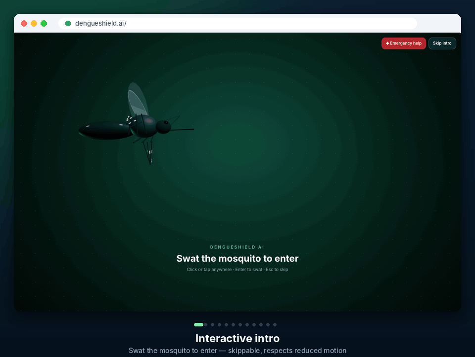

<sub>A full lap of the dashboard: intro → Command Center → Profiling → Wards → Map & Routing → Forecast Lab → Copilot → Evidence → Response → Climate → Learn → Provenance</sub>

</div>

<table>
  <tr>
    <td width="50%" valign="top">
      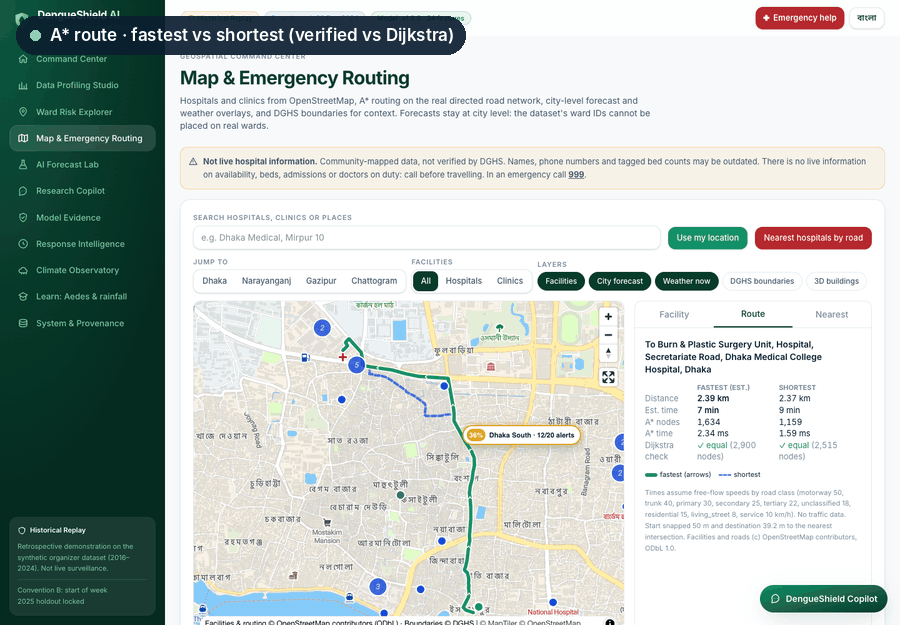
      <p align="center"><b>🚑 Emergency routing</b><br/><sub>914 real OSM hospitals · A* fastest vs shortest · nearest care by road time</sub></p>
    </td>
    <td width="50%" valign="top">
      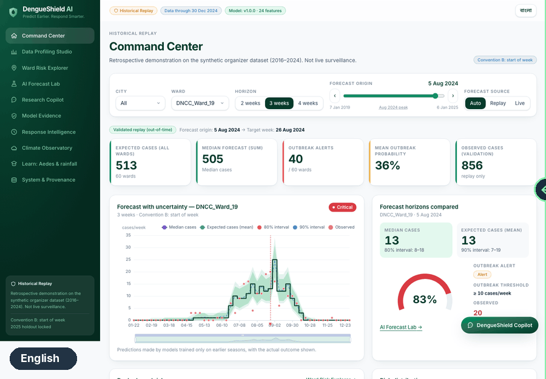
      <p align="center"><b>🌐 English ↔ বাংলা</b><br/><sub>Every page, the emergency panel and search — with Bengali digits and dates</sub></p>
    </td>
  </tr>
  <tr>
    <td colspan="2">
      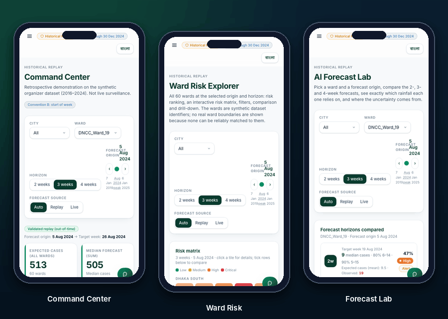
      <p align="center"><b>📱 Built for phones too</b><br/><sub>Compact header, larger touch targets, sticky table columns and a chat button that gets out of the way</sub></p>
    </td>
  </tr>
</table>

<details>
<summary><b>🖼️ Screenshot gallery (click to expand)</b></summary>
<br/>

| | | |
|:---:|:---:|:---:|
| 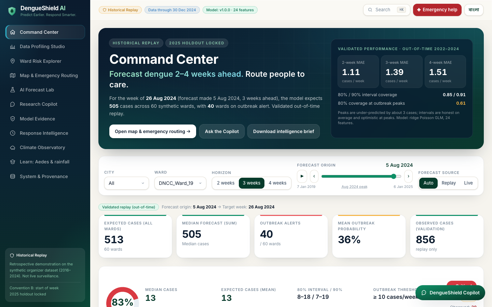<br/><sub>Command Center</sub> | 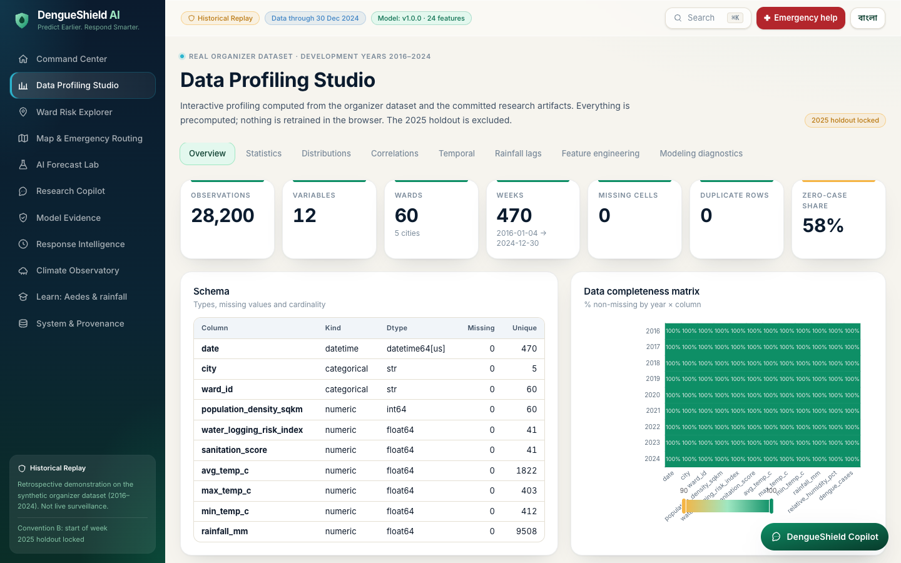<br/><sub>Data Profiling Studio</sub> | 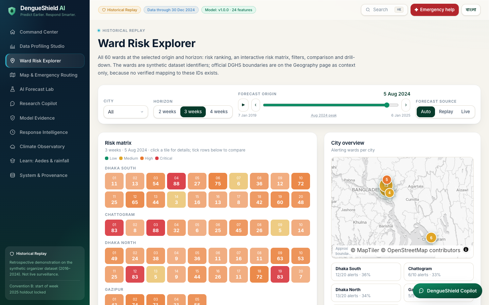<br/><sub>Ward Risk Explorer</sub> |
| 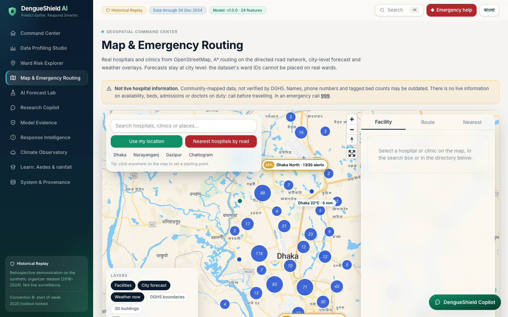<br/><sub>Map & Emergency Routing</sub> | 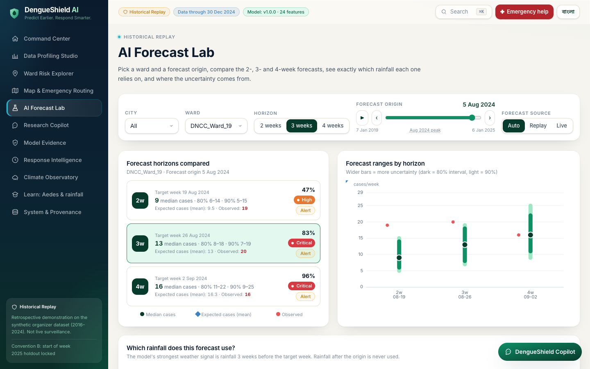<br/><sub>AI Forecast Lab</sub> | 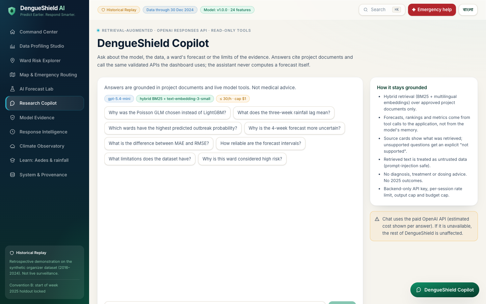<br/><sub>Research Copilot</sub> |
| 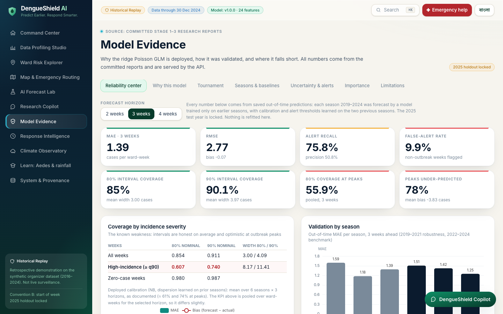<br/><sub>Model Evidence</sub> | 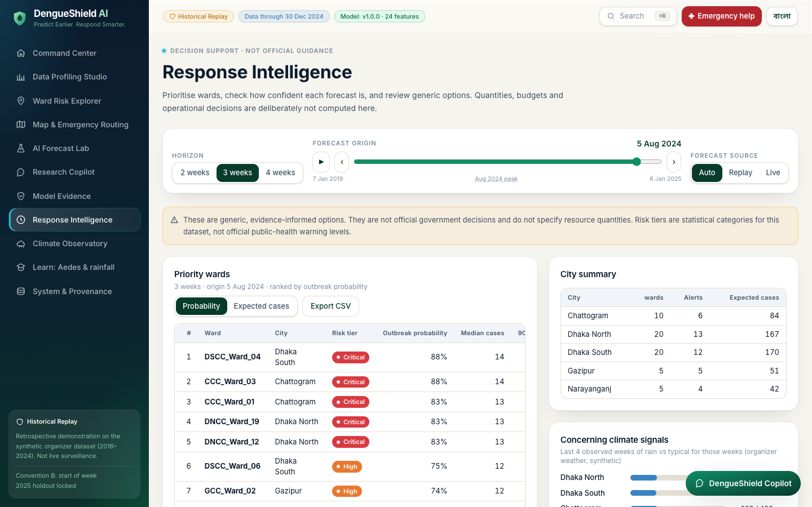<br/><sub>Response Intelligence</sub> | 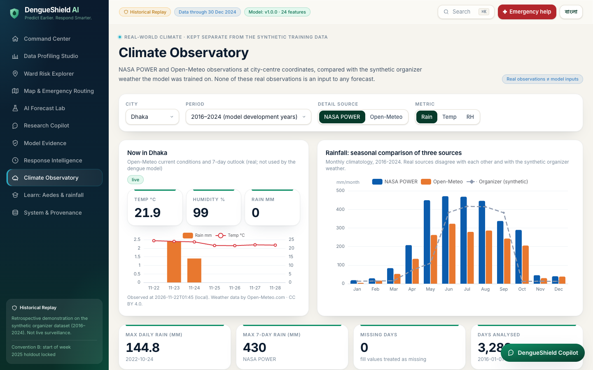<br/><sub>Climate Observatory</sub> |
| 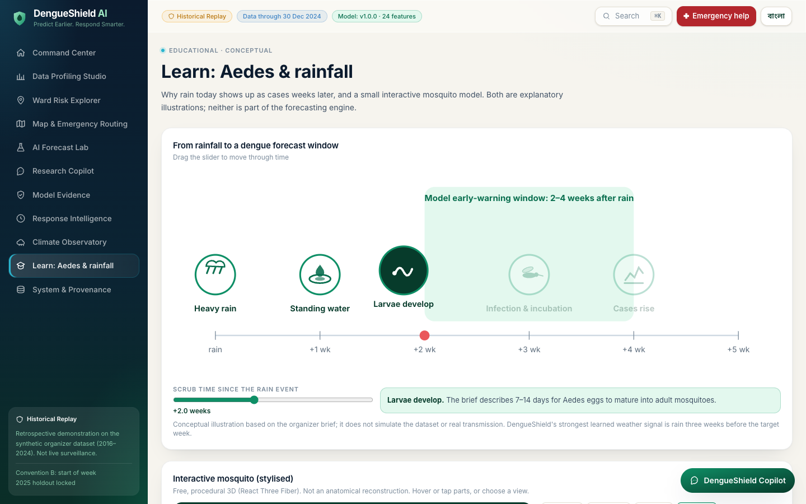<br/><sub>Learn</sub> | 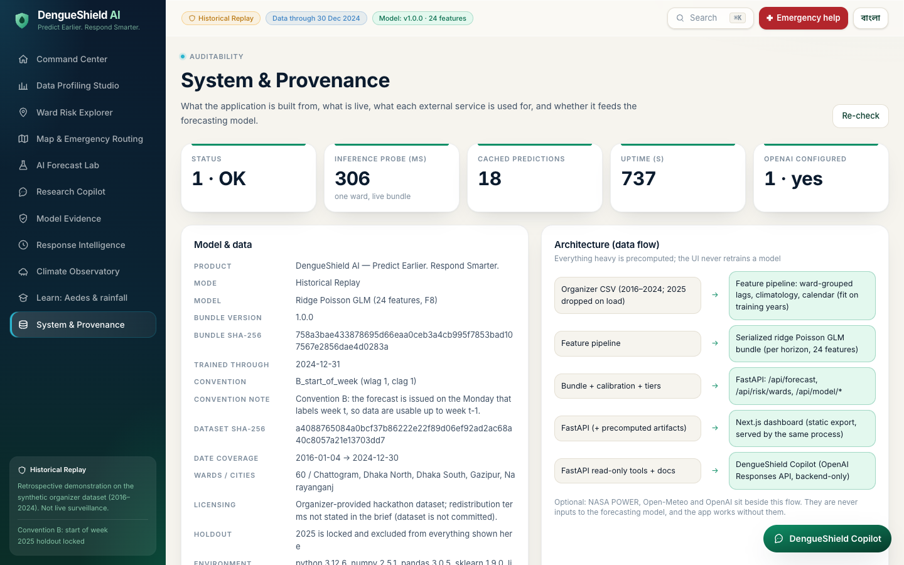<br/><sub>System & Provenance</sub> | 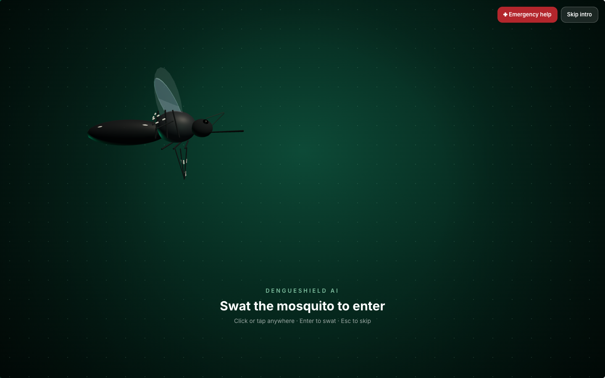<br/><sub>Interactive intro</sub> |

More: [`docs/screenshots/`](docs/screenshots/) (desktop, tablet, mobile, before/after) and [`reports/screenshots/`](reports/screenshots/).
The GIFs above are rebuilt from these screenshots with `python scripts/make_readme_gifs.py`.

</details>

---

## 📑 Table of Contents

- [🏁 Phase 2 onsite final](#-phase-2-onsite-final-operational-engines)
- [✨ Features at a Glance](#-features-at-a-glance)
- [⚡ Quick Start (Linux / macOS)](#-quick-start-linux--macos)
- [🪟 Setup Guide (Windows)](#-setup-guide-windows)
- [🧭 Dashboard Pages](#-dashboard-pages)
- [🧱 Project Architecture](#-project-architecture)
- [📂 Project Structure](#-project-structure)
- [🧠 Model & Science](#-model--science)
- [🔌 API Reference](#-api-reference)
- [🔐 Security & Privacy](#-security--privacy)
- [🔧 Environment Variables](#-environment-variables)
- [🧪 Testing](#-testing)
- [🚀 Deployment](#-deployment)
- [📓 Research Notebooks](#-research-notebooks)
- [📜 Data & Licensing](#-data--licensing)
- [🤖 AI Assistants & External APIs](#-ai-assistants--external-apis-disclosure)
- [🆕 Recent Improvements](#-recent-improvements)
- [🩺 Troubleshooting](#-troubleshooting)
- [🤝 Contributing](#-contributing)

---

## ✨ Features at a Glance

<div align="center">

| 60 wards | 3 horizons | 914 facilities | 53,100 | 11 KB | 2 languages |
|:---:|:---:|:---:|:---:|:---:|:---:|
| across 5 city corporations | 2 · 3 · 4 weeks ahead | real OSM hospitals & clinics | out-of-time replay predictions | serialized model bundle | English · বাংলা |

</div>

| Capability | Description |
|---|---|
| 🔮 **Multi-horizon Forecasting** | 2, 3, and 4-week ahead dengue case predictions per ward |
| 🎯 **Outbreak Alerts** | Calibrated probability-based alerts with tuned thresholds (recall ≈ 0.78) |
| 📊 **Risk Tiering** | Low / Medium / High / Critical classification from training quantiles |
| 🗺️ **Emergency Routing** | A* routing on OSM road graphs to 914 hospitals/clinics, nearest-facility search |
| 🤖 **AI Copilot** | Chat grounded in app data and docs (OpenAI, read-only tools, citations, EN/BN) |
| 🌦️ **Climate Observatory** | Real NASA POWER and Open-Meteo data shown alongside synthetic organizer data |
| 🌐 **Bilingual** | Full English / Bangla interface with Bengali digits and dates |
| 📱 **Responsive** | Desktop, tablet and mobile layouts; accessible keyboard navigation |

---

## ⚡ Quick Start (Linux / macOS)

**Requirements:** Python 3.12+, Node 20.9+ and npm, internet access for the first run.

```bash
git clone -b version-onsite-final https://github.com/A-K-M-Asifuzzaman/EDU_HACKATHON.git && cd EDU_HACKATHON
./scripts/launch.sh            # http://127.0.0.1:8000
# PORT=8100 ./scripts/launch.sh  # if 8000 is busy
```

The script creates `.venv`, installs runtime dependencies, downloads and checksum-verifies the
organizer CSV, builds the Next.js dashboard (`npm ci && npm run build`) and starts a single
process serving both the API and the dashboard.

<p align="center"></p>

<details>
<summary>Diagram source (Mermaid)</summary>

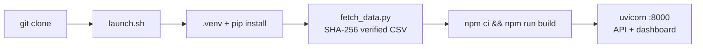

</details>

---

## 🪟 Setup Guide (Windows)

> [!IMPORTANT]
> **Windows does not run the `launch.sh` bash script directly.** Follow these simple step-by-step
> instructions for an easy way to install the project and run it locally.

### Prerequisites

| Tool | Version | How to check | Install from |
|---|---|---|---|
| **Python** | 3.12 or 3.13 | `python --version` | [python.org/downloads](https://www.python.org/downloads/) |
| **Node.js** | 20.9+ (22 recommended) | `node --version` | [nodejs.org](https://nodejs.org/) |
| **npm** | comes with Node | `npm --version` | Bundled with Node.js |
| **Git** | any recent | `git --version` | [git-scm.com](https://git-scm.com/) |

### Step 1 — Clone the Repository

```powershell
git clone -b version-onsite-final https://github.com/A-K-M-Asifuzzaman/EDU_HACKATHON.git
cd EDU_HACKATHON
```

### Step 2 — Download the Dataset

```powershell
python scripts/fetch_data.py
```

This downloads the organizer CSV from the shared sheet and verifies its SHA-256 checksum.
If the download fails (firewall, VPN, etc.), manually download the sheet as CSV from the
hackathon brief link and save it as `data/raw/bangladesh_dengue_large_dataset.csv`.

### Step 3 — Create a Python Virtual Environment & Install Dependencies

```powershell
python -m venv .venv
.\.venv\Scripts\activate
pip install -r requirements.txt
```

### Step 4 — Build the Frontend Dashboard

```powershell
cd frontend
npm ci
npm run build
cd ..
```

### Step 5 — Start the Server

```powershell
.\.venv\Scripts\python -m uvicorn dengueshield.api.main:app --host 127.0.0.1 --port 8000
```

### Step 6 — Open the App 🎉

Open your browser and go to: **http://127.0.0.1:8000**

> [!TIP]
> **Optional environment files** (the app works without them):
> - Copy `.env.example` → `.env` and add your `OPENAI_API_KEY` for the Copilot feature
> - Copy `frontend/.env.example` → `frontend/.env.local` and add your `NEXT_PUBLIC_MAPTILER_KEY` for city map tiles
> - Rebuild the frontend after adding map keys: `cd frontend && npm run build`

### ⏱️ Fresh-clone Measurement

On 22 Nov 2026, an authenticated shallow GitHub clone took about **4 s** on Apple silicon.
With Python 3.12.6, Node 25.2.0, empty pip and npm caches, and a verified 2016–2024 fixture
already in place, `./scripts/launch.sh` reached a healthy API and dashboard in **97 s**.
The measurement excludes the organizer CSV download.

---

## 🧭 Dashboard Pages

| Page | Route | Purpose |
|---|---|---|
| 🏠 **Command Center** | `/` | Hero with the selected week's forecast, validated performance, **time machine** (▶ steps through real weekly forecasts) with verdict rows, and a downloadable **intelligence brief** |
| 📊 **Data Profiling Studio** | `/profiling` | Dataset health, distributions, correlations, seasonality, rainfall-lag analysis |
| 🏘️ **Ward Risk Explorer** | `/wards` | Rank and filter all 60 wards by tier or alert |
| 🗺️ **Map & Emergency Routing** | `/geography` | 914 OSM hospitals/clinics (clustered, searchable, click-to-call), A* routing (fastest vs shortest), nearest hospitals by road time, forecast and weather overlays, optional DGHS boundaries and 3D buildings |
| 🔬 **AI Forecast Lab** | `/lab` | Horizon comparison, driver contributions, uncertainty fan |
| 🤖 **Research Copilot** | `/copilot` | Chat grounded in app data and docs (OpenAI, read-only tools, citations, EN/BN) |
| ✅ **Model Evidence** | `/evidence` | **Reliability center** (per-horizon MAE/RMSE/bias, alert recall/precision, coverage, reliability diagram) and **alert policy simulator** |
| 🚨 **Response Intelligence** | `/response` | Generic response options and **resource planning sandbox**: N teams allocated risk-blind vs by historical risk vs by forecast |
| 🌦️ **Climate Observatory** | `/climate` | Real NASA POWER and Open-Meteo observations/forecast, shown separately from the synthetic organizer data |
| 🦟 **Learn** | `/learn` | Rainfall-to-cases explainer; optional lightweight 3D mosquito |
| 🧾 **System & Provenance** | `/provenance` | Versions, data checksums, integrations status, methodology documents |

**Global features:** ⌘K / Ctrl+K search (pages, wards, hospitals), **Emergency help** button on every page (tap-to-call 999 and 16263, WHO dengue warning signs, nearest hospitals), interactive intro (swat the mosquito, skippable, respects reduced motion).

---

## 🧱 Project Architecture

<p align="center"></p>

<details>
<summary>Diagram source (Mermaid)</summary>

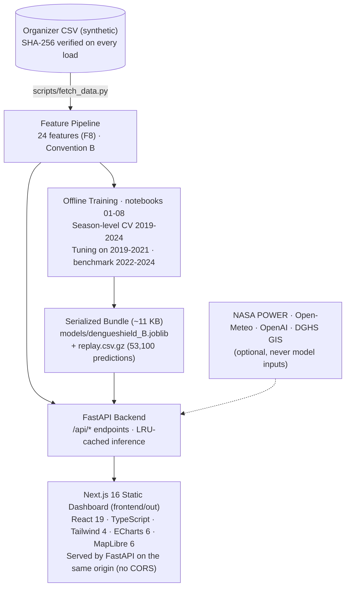

</details>

<details>
<summary>Plain-text version of the diagram</summary>

```
┌──────────────────────────────────────────────────────────────────┐
│                     Organizer CSV (synthetic)                    │
│                   SHA-256 verified on every load                 │
└──────────────┬───────────────────────────────────────────────────┘
               │  scripts/fetch_data.py
               ▼
┌──────────────────────┐    ┌──────────────────────────────────────┐
│   Feature Pipeline   │    │  Offline Training (notebooks 01-08)  │
│  24 features (F8)    │───►│  Season-level CV, 2019-2024          │
│  Convention B        │    │  Hyperparameter search on 2019-2021  │
└──────────┬───────────┘    │  Benchmark window: 2022-2024         │
           │                └──────────┬───────────────────────────┘
           │                           │
           ▼                           ▼
┌──────────────────────┐    ┌──────────────────────────────────────┐
│  FastAPI Backend      │◄──│  Serialized Bundle (~11 KB)           │
│  /api/* endpoints     │    │  models/dengueshield_B.joblib         │
│  LRU cached inference │    │  + replay.csv.gz (53,100 predictions) │
└──────────┬───────────┘    └──────────────────────────────────────┘
           │
           ▼
┌──────────────────────────────────────────────────────────────────┐
│              Next.js 16 Static Dashboard (frontend/out)          │
│   React 19 · TypeScript · Tailwind 4 · ECharts 6 · MapLibre 6   │
│           Served by FastAPI on the same origin (no CORS)         │
└──────────────────────────────────────────────────────────────────┘
```

</details>

Architecture: a concise overview in [ARCHITECTURE.md](ARCHITECTURE.md) (data flow, validation split, model selection, cost controls) and the complete technical reference with every diagram in [docs/architecture/COMPLETE_ARCHITECTURE.md](docs/architecture/COMPLETE_ARCHITECTURE.md).

---

## 📂 Project Structure

<details>
<summary><b>Show the full tree</b></summary>

```
EDU_HACKATHON/
├── dengueshield/              # Python library (the core engine)
│   ├── api/                   #   FastAPI app: main.py, store.py, schemas.py, climate.py,
│   │                          #     geo.py, integrations.py, rag.py (Copilot)
│   ├── calibration/           #   NB intervals, peak adjustment, risk tiers
│   ├── evaluation/            #   Ablation tournament, CV folds, model fitting, quality checks
│   ├── features/              #   204 candidate → 24 selected features (pipeline, families, ops)
│   ├── inference/             #   ForecastBundle: predict, explain, serialize
│   ├── models/                #   Model zoo, tournament, ensemble, season predictions
│   ├── optimization/          #   Optuna hyperparameter search
│   ├── data.py                #   Panel loader with SHA-256 check, drops 2025
│   ├── baselines.py           #   Naïve and GLM baselines (Stage 1)
│   ├── decision.py            #   Alert curve, resource allocation, decision-support logic
│   ├── metrics.py             #   MAE, RMSE, bias, coverage, outbreak metrics
│   ├── routing.py             #   A*, Dijkstra, nearest-facility on OSM road graphs
│   └── validation.py          #   Expanding-window cross-validation
├── frontend/                  # Next.js 16 static dashboard
│   ├── app/                   #   11 route pages (/, /climate, /copilot, /evidence, etc.)
│   ├── components/            #   Charts, map, emergency, chat, shell, UI atoms, 3D mosquito
│   ├── lib/                   #   API client, i18n (EN/BN), formatting, context
│   ├── scripts/               #   Build helpers (copy-maplibre.mjs)
│   └── tests/e2e/             #   Playwright browser tests
├── models/                    # Serialized model bundles
│   ├── dengueshield_A.joblib  #   Convention A (end-of-week origin)
│   └── dengueshield_B.joblib  #   Convention B (start-of-week origin, primary)
├── app_data/                  # Precomputed artifacts served by the API
│   ├── replay.csv.gz          #   53,100 out-of-time predictions
│   ├── rag_index.npz          #   Copilot retrieval index (512-dim embeddings)
│   ├── *.json                 #   Profile, distributions, correlations, seasonality, etc.
│   └── geo/                   #   OSM facilities (914), road graphs (Dhaka + Chattogram)
├── data/                      # Organizer dataset (not committed; fetched at runtime)
│   └── raw/                   #   bangladesh_dengue_large_dataset.csv (SHA-256 verified)
├── notebooks/                 # Reproducible research notebooks (01-08)
├── reports/                   # Generated CSV, JSON, and figures from notebooks
│   ├── audit/                 #   Data integrity audit results
│   ├── eda/                   #   16 EDA figures, 20+ tables
│   ├── baselines/             #   Baseline model metrics
│   ├── features/              #   Ablation results, feature selection, importance
│   ├── model_tournament/      #   Champion selection, Optuna, calibration, diagnostics
│   └── screenshots/           #   App screenshots (desktop, mobile)
├── docs/                      # Methodology and architecture documents
│   ├── media/                 #   README hero banner and animated GIFs
│   ├── screenshots/           #   Before/after UI screenshots
│   └── *.md                   #   Validation, calibration, features, model selection, etc.
├── scripts/                   # Build and deployment scripts
│   ├── launch.sh              #   One-command local launch (Linux/macOS)
│   ├── fetch_data.py          #   Download + SHA-256 verify the organizer CSV
│   ├── build_geodata.py       #   Build OSM facility + road graph data (offline)
│   ├── deploy_space.py        #   Deploy backend to Hugging Face Spaces
│   └── make_readme_gifs.py    #   Rebuild the README GIFs from the screenshots
├── tests/                     # pytest test suite
│   ├── test_api.py            #   API contract tests
│   ├── test_routing.py        #   A* vs Dijkstra correctness
│   ├── test_temporal_invariants.py  # Leakage and alignment checks
│   ├── test_models.py         #   Model training and prediction tests
│   └── ...                    #   Calibration, features, decision, deploy config, geo, lock
├── .github/workflows/         # CI: pytest, typecheck, build, Playwright e2e
├── Dockerfile                 # Full-stack container (dashboard + API)
├── Dockerfile.backend         # API-only container (for Hugging Face Spaces / Render)
├── requirements.txt           # Runtime Python dependencies (10 packages)
├── requirements-research.txt  # Research + test dependencies (adds XGBoost, CatBoost, Optuna, etc.)
├── pyproject.toml             # Project metadata, pytest config
├── vercel.json                # Vercel: build frontend, proxy /api to backend
├── render.yaml                # Render Blueprint (alternative to HF Spaces)
└── ARCHITECTURE.md            # High-level architecture overview
```

</details>

---

## 🧠 Model & Science

### 🏆 Champion Model

**Ridge Poisson GLM** with 24 features (F8 feature set), one model per horizon.

| Metric | h = 2 weeks | h = 3 weeks | h = 4 weeks |
|---|---|---|---|
| **MAE** (Poisson-median, 2022-2024) | 1.107 | 1.393 | 1.512 |
| 80% interval coverage (all weeks) | 0.854 | — | — |
| 90% interval coverage (all weeks) | 0.911 | — | — |
| Alert recall / precision (pooled replay) | — | 0.758 / 0.508 | — |

<details>
<summary>Both origin conventions vs the Stage 1 benchmark (MAE, validation seasons 2022-2024)</summary>

| Origin convention | h = 2 | h = 3 | h = 4 |
|---|---|---|---|
| **Start-of-week origin (B, primary)** | 1.107 | 1.393 | 1.512 |
| End-of-week origin (A) | 1.069 | 1.152 | 1.459 |
| Stage 1 benchmark (end-of-week) | 1.094 | 1.213 | 1.517 |

Stage 3 found no reliable accuracy gain over Stage 2. Its gains are robustness over six seasons,
calibrated 80% / 90% intervals and an outbreak alert with recall 0.78 (precision 0.53) on the
Stage 3 validation seasons; the pooled replay shown in the app gives 0.758 / 0.508.
Details: [`docs/model_selection.md`](docs/model_selection.md), [`docs/calibration_and_uncertainty.md`](docs/calibration_and_uncertainty.md).

</details>

### 🤔 Why This Model

**Full model comparison:** [`reports/MODEL_COMPARISON.md`](reports/MODEL_COMPARISON.md) and the machine-readable
[`reports/MODEL_COMPARISON.csv`](reports/MODEL_COMPARISON.csv): 28 model variants (23 from the Stage 3 tournament + 5 classical benchmarks
added in V3) and 5 baselines on identical season folds, with MAE, RMSE, R², peak-week error, outbreak alerts, cost and selection status. It is
also explorable in the app (Model Evidence → Model comparison).

The selection rule was fixed before the tuned and ensemble results were seen: shortlist everything
within 0.05 MAE of the best, then take the simplest. Tuned XGBoost, LightGBM, CatBoost, hurdle
models and 9 ensembles did not beat the GLM by a meaningful margin. The GLM gives:
- Best high-incidence behaviour among shortlisted candidates
- Lowest fold-to-fold variability
- Additive per-driver explanations (log-rate contributions)
- Sub-millisecond prediction, 11 KB bundle

### ⚠️ Known Limitations

- Intervals **under-cover outbreak peaks**: pooled over all out-of-time weeks (2019–2024), 80% intervals cover 0.57 and 90% intervals 0.71 of
  peak weeks, against 0.85 / 0.91 overall (earlier documents quoted 0.607 / 0.740, an unweighted mean over season × horizon cells).
- Peaks are under-predicted 77% of the time, by about 3.7 cases on average (pooled). One canonical source: `app_data/metrics_canonical.json`.
- The 2022–2024 MAE figures come from seasons also used to choose the model: they are validation results, not a blind test. 2025 is sealed.
- The dataset is **synthetic**; nothing in the app is live surveillance
- Risk tiers are **statistical categories** from training quantiles, not official public-health warning levels

### 🔒 Validation Protocol

Each expanding outer fold fits on earlier seasons and predicts a later full season (2019-2024).
Interval dispersion and alert thresholds are calibrated on the two preceding validation seasons only.
The 2025 holdout is **sealed and excluded** from fit, selection, calibration and scoring. See
[`docs/validation_protocol.md`](docs/validation_protocol.md) and [`docs/holdout_protocol.md`](docs/holdout_protocol.md).

<p align="center"></p>

<details>
<summary>Diagram source (Mermaid)</summary>

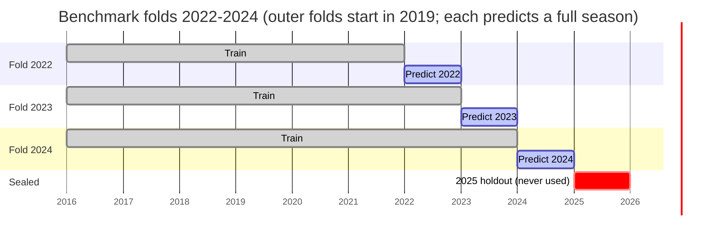

</details>

---

## 🔌 API Reference

The API is self-documented at **`/docs`** (Swagger UI) on a running server.

| Group | Key Endpoints |
|---|---|
| **Health & Metadata** | `GET /api/health`, `GET /api/metadata`, `GET /api/cities`, `GET /api/wards` |
| **Forecasts** | `GET /api/forecast`, `GET /api/forecast/compare`, `GET /api/forecast/series`, `GET /api/risk/wards` |
| **Model Evidence** | `GET /api/model/{metrics,features,validation,calibration,diagnostics}` |
| **Data Profile** | `GET /api/data/{profile,distributions,correlations,seasonality,lag-analysis}` |
| **Decision Support** | `GET /api/decision/{alert-curve,allocate,allocation-season}` |
| **Geospatial** | `GET /api/facilities`, `GET /api/route`, `GET /api/emergency/{nearest,info}` |
| **Climate** | `GET /api/climate/{observations,current,compare}` |
| **Copilot** | `POST /api/assistant/chat` (SSE stream), `GET /api/assistant/status` |
| **Documents** | `GET /api/docs`, `GET /api/docs/read` (allow-listed Markdown only) |
| **Integrations** | `GET /api/integrations/status`, `GET /api/geo/dghs/{status,filters,wards}` |

---

Team, responsibilities and how contributions are recorded: `CONTRIBUTORS.md`. Decision-support methods and evidence: `docs/decision_support.md`. Three-minute walkthrough: `docs/demo_script.md`. Screenshots: `docs/screenshots/`, `reports/screenshots/`.

## 🔐 Security & Privacy

> [!CAUTION]
> **Never commit API keys, passwords, or secrets to the repository.** All secret files
> (`.env`, `.env.local`, `.env.*.local`) are git-ignored. Review the `.gitignore` before
> making any changes to ensure secrets remain excluded.

### Accounts and Roles (V4)

<p align="center"></p>

Public forecasting needs no account. Officers review model alerts and draft generic response plans; administrators grant roles and approve
other people's plans. Firebase Authentication handles sign-in, and the FastAPI backend checks the token and the role on every protected request.
Setup and the full list of checks: [`docs/AUTH_FIREBASE.md`](docs/AUTH_FIREBASE.md).

### Secret Management

| Secret | Location | Exposure |
|---|---|---|
| `OPENAI_API_KEY` | Backend `.env` only | Never reaches the browser. Used server-side for Copilot. |
| `ACCESS_PASSWORD` | Platform env (HF Spaces / Render) | HTTP Basic auth. `/api/health` stays open for probes. |
| `OPENAI_BUDGET_USD` | Platform env | In-memory spend guard. Also set a hard limit in the OpenAI dashboard. |
| `NEXT_PUBLIC_MAPTILER_KEY` | `frontend/.env.local` | Browser-visible by design. **Restrict by domain** in MapTiler dashboard. |

### Security Controls

| Control | Implementation |
|---|---|
| **Secrets never in git or browser bundle** | `.gitignore`, `.dockerignore`, `.vercelignore`; Playwright secret scan of served assets |
| **Input validation** | Pydantic types, regex patterns, bounded numbers (horizon 2-4, teams 1-60, simplify ≤ 0.01) |
| **Injection-safe external queries** | DGHS filter values quoted and validated; facility IDs pattern-checked |
| **Bounded compute** | Routing snap ≤ 1 km, insight samples ≤ 2,500, DGHS ≤ 3,000 features, Copilot rate and budget limits |
| **Data integrity** | Organizer CSV SHA-256 verified on every load; model bundle checksum pinned |
| **Access gate** | Optional shared-password gate (HTTP Basic) for private deployments; `/api/health` stays open |
| **Copilot guardrails** | Read-only tools, 900 output tokens, 30 req/hr per client, 1 h answer cache, USD budget guard, retrieval from allow-listed docs only |
| **Holdout enforcement** | 2025 data dropped on load; API refuses origins beyond last data week + 1 |
| **Prompt injection defense** | Retrieval limited to approved project documents; tool outputs are data, not instructions |

### Integrity Boundaries

| Boundary | Rule |
|---|---|
| Organizer data vs real weather | NASA POWER / Open-Meteo shown beside synthetic data, never a model input |
| Live bundle vs Historical Replay | Replay = out-of-time predictions used for accuracy claims; bundle values for ≤ 2024 are labelled in-sample |
| LLM vs numbers | Copilot quotes only numbers from read-only tools; never computes forecasts |
| Real facilities vs synthetic wards | Hospitals/roads are real OSM; forecasts appear on the map only as city-level aggregates |
| Frontend vs secrets | Only public map keys are in `frontend/.env.local`; `OPENAI_API_KEY` stays in backend `.env` |

---

## 🔧 Environment Variables

### Backend (`.env` in repo root — git-ignored)

```bash
OPENAI_API_KEY=sk-your-key-here        # Optional: enables Copilot. Without it: retrieval-only fallback
# OPENAI_MODEL=gpt-5.4-mini            # Optional: override model
# OPENAI_BUDGET_USD=1.00               # Optional: in-memory spend guard (resets on restart)
# ACCESS_PASSWORD=your-password         # Optional: HTTP Basic auth for all routes except /api/health
```

### Frontend (`frontend/.env.local` — git-ignored)

```bash
NEXT_PUBLIC_MAPTILER_KEY=your_key      # Optional: map tiles. Without it: blank basemap, facilities/routing still work
NEXT_PUBLIC_MAP_PROVIDER=maptiler      # Optional: maptiler (default) or mapbox
# NEXT_PUBLIC_MAPBOX_TOKEN=your_token  # Optional: if using Mapbox instead
```

---

## 🧪 Testing

```bash
# Backend unit tests (leakage, alignment, models, A* vs Dijkstra, decision tools, API contracts)
pip install -r requirements-research.txt
python -m pytest tests -q

# Frontend typecheck
cd frontend && npx tsc --noEmit

# Frontend build verification
npm run build

# Playwright browser tests (requires a running server)
npx playwright install --with-deps chromium
npx playwright test
```

### What the tests cover

| Suite | Checks |
|---|---|
| `test_temporal_invariants.py` | No future leakage, chronological alignment |
| `test_models.py` | Model training, prediction shape, reproducibility |
| `test_calibration_inference.py` | Bundle inference, interval calibration, risk tiers |
| `test_routing.py` | A* equals Dijkstra on 400/400 test pairs |
| `test_api.py` | API endpoint contracts, error handling |
| `test_decision.py` | Decision tools without look-ahead |
| `test_feature_pipeline.py` | Feature availability at forecast origin |
| `test_deploy_config.py` | `pyproject.toml` matches `requirements.txt` |
| `test_geo.py` | Geospatial data integrity |
| `test_lock_and_reproduction.py` | 2025 holdout enforcement |
| Playwright `app.spec.ts` | All routes, console errors, mobile 390 px, Bangla, map routing, emergency, intro, reliability, simulator, sandbox, brief, search, secret scan |

---

## 🚀 Deployment

### Production Architecture

| Component | Platform | Config |
|---|---|---|
| **Dashboard** | Vercel (static site) | `vercel.json`, `.vercelignore` |
| **API** | Hugging Face Spaces (Docker) | `Dockerfile.backend`, `scripts/deploy_space.py` |

<p align="center"></p>

<details>
<summary>Diagram source (Mermaid)</summary>

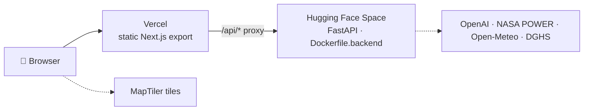

</details>

Vercel serves the static Next.js export and proxies `/api/*` to the FastAPI backend on HF Spaces.
Detailed steps, secrets and cost controls are in [`docs/deployment.md`](docs/deployment.md).

### Docker (local or single-host)

```bash
# Full-stack (dashboard + API in one container)
docker build -t dengueshield . && docker run --rm -p 10000:10000 dengueshield

# Backend only
docker build -f Dockerfile.backend -t dengueshield-api . && docker run --rm -p 7860:7860 dengueshield-api
```

### Cost Controls

| Resource | Control |
|---|---|
| Model inference | CPU only, ≈ 0.25 s cold / 6 ms warm (LRU cached). No GPU required |
| OpenAI Copilot | ≈ \$0.002-0.004 per answer. 30 req/hr, 900 output tokens, USD budget guard |
| Weather APIs | Per-city caches (history 24 h, current 10 min), stale fallbacks, no cost |
| Routing | 100% local — no external API calls. A* median 6.5 ms |
| DGHS GIS | 6 s timeout, 60 s circuit breaker, 7-day cache with stale fallback |

---

## 📓 Research Notebooks

| Notebook | Purpose | Runtime |
|---|---|---|
| `01_data_audit.ipynb` | Data integrity audit | Seconds |
| `02_eda.ipynb` | Exploratory analysis (16 figures, 20+ tables) | < 1 min |
| `03_validation_and_baselines.ipynb` | Validation protocol, naïve and GLM baselines | < 1 min |
| `04_feature_engineering.ipynb` | 204 candidate features, availability, quality | < 1 min |
| `05_feature_ablation.ipynb` | Family ablation tournament | ≈ 25 min (first run) |
| `06_feature_selection.ipynb` | Selection rule, final F8 set | ≈ 25 min (first run) |
| `07_model_tournament.ipynb` | 11 families × 2 feature sets, Optuna tuning | ≈ 18 min |
| `08_model_diagnostics.ipynb` | Intervals, alerts, risk tiers, diagnostics | ≈ 1.5 min |

```bash
# Install research dependencies (adds XGBoost, CatBoost, Optuna, Jupyter, matplotlib)
pip install -r requirements-research.txt

# Run all notebooks
for nb in 01_data_audit 02_eda 03_validation_and_baselines 04_feature_engineering \
          05_feature_ablation 06_feature_selection 07_model_tournament 08_model_diagnostics; do
  jupyter nbconvert --to notebook --execute --inplace --ExecutePreprocessor.timeout=7200 notebooks/$nb.ipynb
done
```

Later runs take seconds because results are cached in `.cache/` (git-ignored).

<details>
<summary><b>Where every research output lives</b></summary>

| Output | Location |
|---|---|
| Data integrity audit | `notebooks/01_data_audit.ipynb`, `docs/data_audit.md`, `reports/audit/` |
| Exploratory analysis | `notebooks/02_eda.ipynb`, `reports/eda/` |
| Validation and baselines | `notebooks/03_validation_and_baselines.ipynb`, `reports/baselines/`, `docs/validation_protocol.md` |
| Feature library, availability, quality | `notebooks/04_feature_engineering.ipynb`, `docs/feature_engineering.md`, `docs/feature_definitions.md` |
| Feature ablation tournament | `notebooks/05_feature_ablation.ipynb`, `reports/features/` |
| Selection, importance, conventions | `notebooks/06_feature_selection.ipynb`, `docs/feature_selection_report.md`, `reports/features/selection/` |
| Model tournament | `notebooks/07_model_tournament.ipynb`, `docs/model_selection.md`, `reports/model_tournament/` |
| Diagnostics, intervals, alerts, risk tiers | `notebooks/08_model_diagnostics.ipynb`, `docs/calibration_and_uncertainty.md` |
| Decision support | `docs/decision_support.md` |
| Three-minute walkthrough | `docs/demo_script.md` |
| Deployable bundles | `models/dengueshield_B.joblib` (primary), `models/dengueshield_A.joblib`; `docs/stage4_handoff.md` |
| One-shot 2025 test procedure (not run) | `docs/holdout_protocol.md` |

</details>

---

## 📜 Data & Licensing

### Organizer Dataset

The organizer dataset is **not committed** to the repository. It is fetched at runtime by
`scripts/fetch_data.py` and verified with SHA-256:

| File | SHA-256 | Size |
|---|---|---|
| `bangladesh_dengue_large_dataset.csv` | `a4088765...13703dd7` | 2.6 MB (31,320 rows) |

The dataset is **synthetic** and provided by the hackathon organizers. Redistribution terms were
not stated in the brief.

### Licenses

| Data / Service | License | Attribution |
|---|---|---|
| OpenStreetMap (facilities, roads) | ODbL 1.0 | © OpenStreetMap contributors |
| NASA POWER | NASA open data | Acknowledged in Climate Observatory |
| Open-Meteo | CC BY 4.0 | Attribution in Climate Observatory |
| MapTiler | Commercial (free tier) | Attribution on the map |
| DGHS Bangladesh GIS | Unverified terms | Context display only |

---

## 🤖 AI Assistants & External APIs (Disclosure)

### Development Tools

| Tool | Provider | Used for |
|---|---|---|
| Claude Code (Opus & Sonnet) | Anthropic | Development assistant: website, API, map, routing, suggestions, test writing, documentation |
| Claude (claude.ai) | Anthropic | README redesign, animated README banner and GIFs, UI polish and Bangla translation patches |
| Codex | OpenAI | Release audit, browser/API verification, Vercel deployment, architecture documentation |

**Phase 2 onsite final (27 Nov 2026).** Claude Code (Anthropic, Opus) wrote most of the onsite code, tests and documentation
(Stages 0-5: resource allocation, hospital overflow, vector-control simulator, dispatch notices, offline operation) from the team
lead's stage-by-stage specifications. The lead set the requirements and owner decisions, reviewed the scope, and authorised each
commit and push; the commits appear under the lead's GitHub account. The intervention effects in the simulator are user-set
assumptions, not AI-generated or measured efficacy, and every reported number comes from executed code and tests.

The team directed the work and set the requirements, reviewed the results, and chose the validation
protocol and model. Reported numbers come from executed notebooks and saved artifacts, not from an
AI model's statements, and the tests in `tests/` check them.

### Runtime External APIs (all optional)

| Service | Purpose | Key Required | Called From |
|---|---|---|---|
| OpenAI (gpt-5.4-mini, text-embedding-3-small) | Copilot only | Yes (`OPENAI_API_KEY`) | Backend |
| NASA POWER | Real weather observations | No | Backend |
| Open-Meteo | Real weather archive + forecast | No | Backend |
| MapTiler | Map tiles, 3D buildings, place search | Yes (`NEXT_PUBLIC_MAPTILER_KEY`) | Browser |
| DGHS Bangladesh GIS (ArcGIS) | Official ward boundaries (display only) | No | Backend |
| OpenStreetMap Overpass | Hospitals, clinics, roads | No | **Build-time only** |

If any external service fails, its panel shows a status message and every other page keeps working.
The forecasts themselves need no external service: they run locally from the committed 11 KB bundle.

---

## 🆕 Recent Improvements

<details>
<summary><b>UI, mobile and Bangla polish (commits 07–27)</b></summary>

| Area | What changed |
|---|---|
| 🔎 **SEO & sharing** | Every page has its own browser-tab title; Open Graph tags and a 1200×630 link-preview image for Facebook / WhatsApp |
| 🌐 **Bangla everywhere** | 404 page, search palette, emergency panel (warning signs, 999 and 16263), map controls and tabs, and the headers of Lab, Profiling, Wards, Evidence, Response, Climate, Copilot, Provenance and Learn |
| 📱 **Mobile** | One-line compact header with an **SOS** button, search button on phones, chat button that hides while scrolling down, 36–40 px touch targets, header chips that never wrap |
| ♿ **Accessibility** | Mobile menu closes with Escape and locks background scroll; first table column stays pinned while scrolling sideways |

</details>

---

## 🩺 Troubleshooting

| Problem | Solution |
|---|---|
| `ModuleNotFoundError: No module named 'resource'` | Windows-only: already fixed in this codebase (conditional import in `dengueshield/evaluation/ablation.py`) |
| npm script execution blocked on Windows | Run `Set-ExecutionPolicy -ExecutionPolicy RemoteSigned -Scope CurrentUser` in PowerShell, or use `cmd /c "npm ci"` |
| Dataset download fails | Download the CSV manually from the hackathon brief link → save as `data/raw/bangladesh_dengue_large_dataset.csv` |
| Map shows blank basemap | Add a MapTiler key to `frontend/.env.local` and rebuild the frontend. Facilities and routing still work without it |
| Copilot says "retrieval only" | Add `OPENAI_API_KEY` to `.env`. Without it, the Copilot falls back to keyword retrieval |
| Port 8000 already in use | Use a different port: `--port 8100` (or `PORT=8100 ./scripts/launch.sh` on Linux/macOS) |
| HF Space is sleeping | Open `/api/health` to wake it. Free Spaces sleep after ~48 hours without traffic |

---

## 🤝 Contributing

1. Fork the repository and create a feature branch
2. Install the research dependencies: `pip install -r requirements-research.txt`
3. Run the test suite before pushing: `python -m pytest tests -q`
4. Make sure the frontend builds cleanly: `cd frontend && npm run build`
5. Add any new AI assistant or external API to the disclosure table above
6. Changed the UI? Refresh the screenshots in `docs/screenshots/` and run `python scripts/make_readme_gifs.py`

---

## 📌 Status

| Stage | State | Scope |
|---|:---:|---|
| **Stage 1-3** | ✅ Complete | Data audit, EDA, leak-safe validation, 204-feature pipeline, model tournament, calibrated intervals, outbreak alerts, risk tiers, deployable bundles |
| **Stage 4** | ✅ Complete | FastAPI + Next.js platform, Copilot, external weather hub, tests |
| **2025 test year** | 🔒 Sealed | Not used for fit, selection, calibration or scoring |

The dataset is synthetic; nothing in the app is live surveillance, and the demo mode is labelled **Historical Replay**.

---

<div align="center">

🦟 **DengueShield AI** — EDU AI Engineering Hackathon 2026<br/>
<em>Predict Earlier. Respond Smarter.</em>

<sub>If this project helped you, consider giving it a ⭐</sub>

</div>
