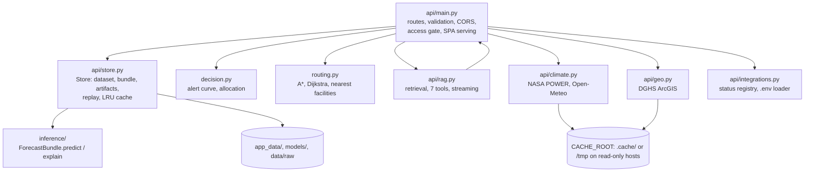
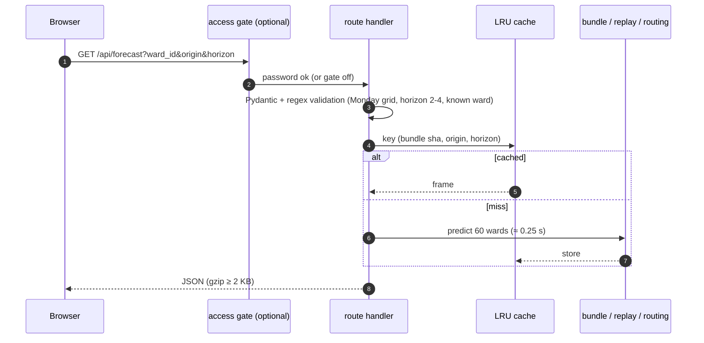
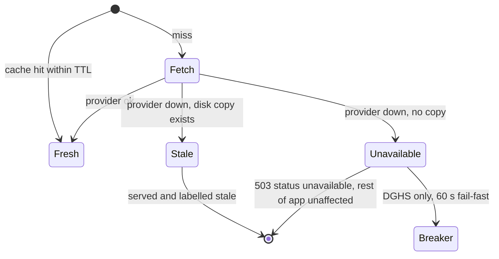
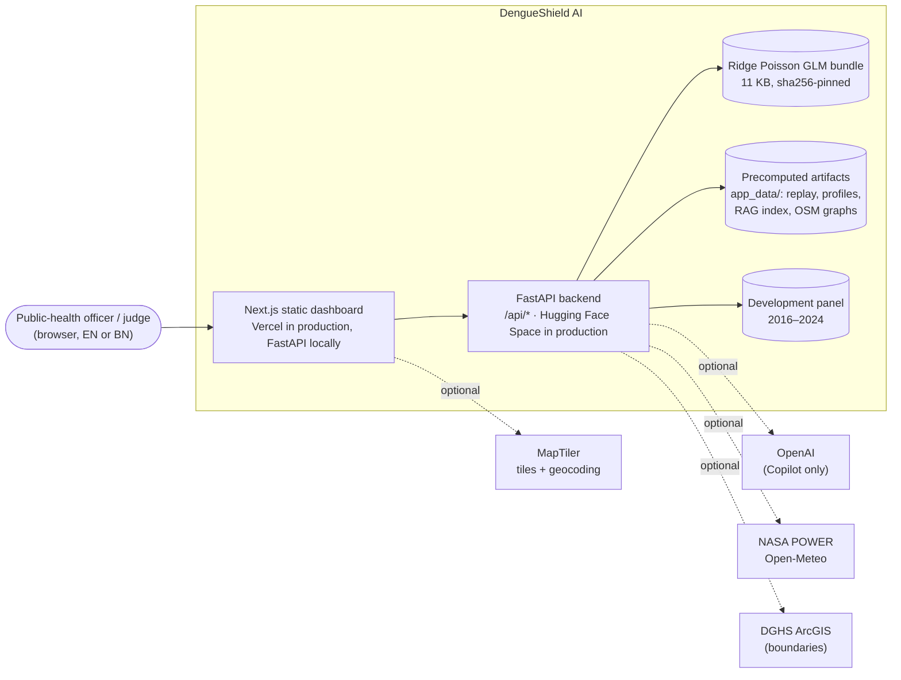

# Backend: FastAPI service

[Architecture overview](../../ARCHITECTURE.md)

Interactive reference: `/docs` (OpenAPI) on a running server

## Modules

## Request lifecycle

## Endpoint groups

| Group | Endpoints | Source |
|---|---|---|
| Health and metadata | `/api/health`, `/api/metadata`, `/api/cities`, `/api/wards`, `/api/integrations/status` | Store |
| Forecasts | `/api/forecast`, `/api/forecast/compare`, `/api/forecast/series`, `/api/risk/wards`, `/api/reports/summary` | bundle (live) or replay |
| Model evidence | `/api/model/{metrics,features,validation,calibration,diagnostics}` | committed artifacts |
| Data profile | `/api/data/{profile,distributions,correlations,seasonality,lag-analysis}`, `/api/weather/historical` | `app_data/` |
| Decision support | `/api/decision/{alert-curve,allocate,allocation-season}` | replay + pre-origin panel |
| Geospatial | `/api/facilities`, `/api/route`, `/api/emergency/{nearest,info}`, `/api/routing/status`, `/api/geo/dghs/{status,filters,wards}` | `app_data/geo`, DGHS |
| Climate | `/api/climate/{observations,current,compare}` | NASA POWER, Open-Meteo |
| Copilot | `/api/assistant/chat` (SSE), `/api/assistant/status` | OpenAI (optional) |
| Documents | `/api/docs`, `/api/docs/read` | allow-listed Markdown only |

## Failure handling

## System context

Solid lines are required; dotted lines are optional services with timeouts, caches and graceful fallbacks.
