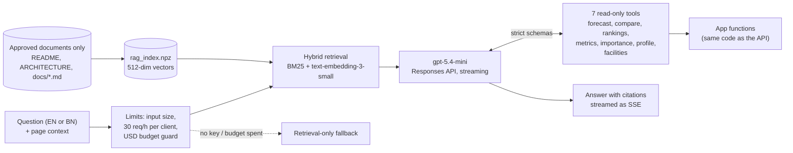
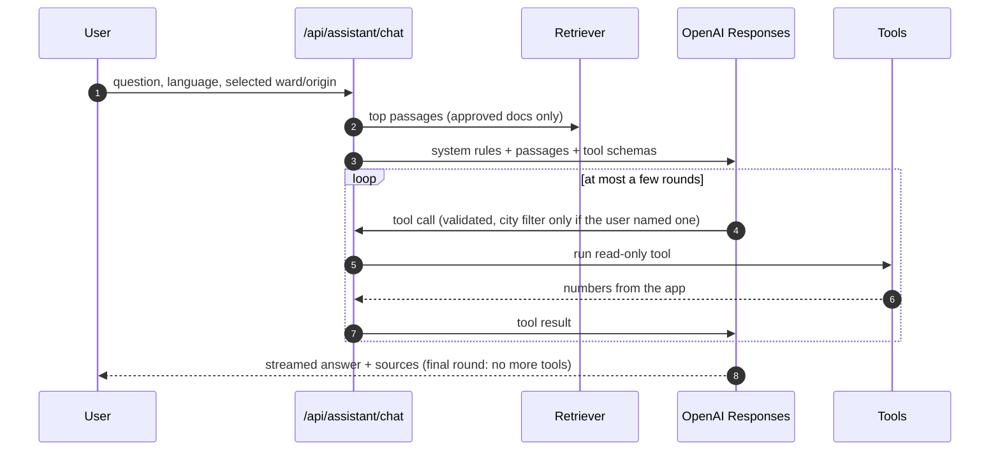

# Copilot: grounded retrieval and read-only tools

[← Architecture overview](../../ARCHITECTURE.md)

## Components

## One answer

| Guard | Behaviour |
|---|---|
| Secrets | Key only in the backend `.env`; the model is told never to reveal configuration, and secret scans run in tests |
| Holdout | Tools cannot read 2025; requests for 2025 actuals are refused |
| Cost | 900 output tokens, 1 h cache for identical questions, usage log without message content, ≈ $0.002-0.004 per answer |
| Prompt injection | Retrieval is limited to an allow-list of project documents; tool outputs are data, not instructions |
