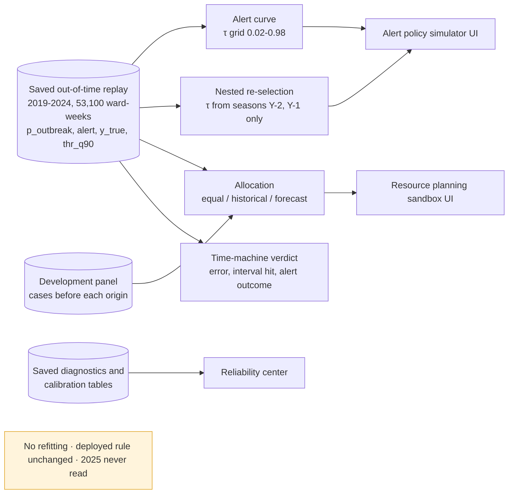
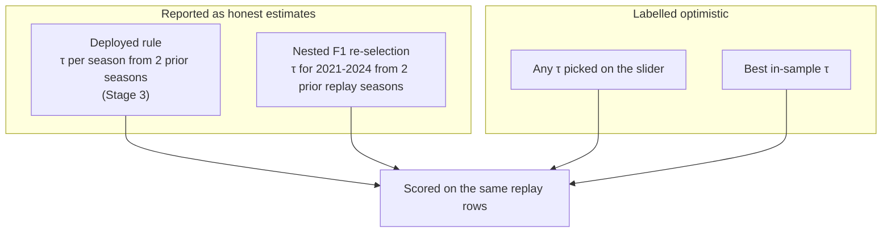

# Decision support: reliability, alert policy, time machine, resource planning

[← Architecture overview](../../ARCHITECTURE.md) · Evidence and numbers: [`decision_support.md`](../decision_support.md)

## Inputs and outputs

## Why the simulator cannot leak

## Resource sandbox rules

| Rule | Ranking key (available at the origin) | Tie-break |
|---|---|---|
| Equal (risk-blind) | round-robin across cities | ward ID |
| Historical risk | mean weekly cases strictly before the origin | ward ID |
| Forecast | calibrated P(outbreak) at the origin | expected cases, then ward ID |

Outcome = retrospective coverage of actual outbreak wards and cases in the target week. It is a planning simulation, not a claim about prevented infections or real capacity.
