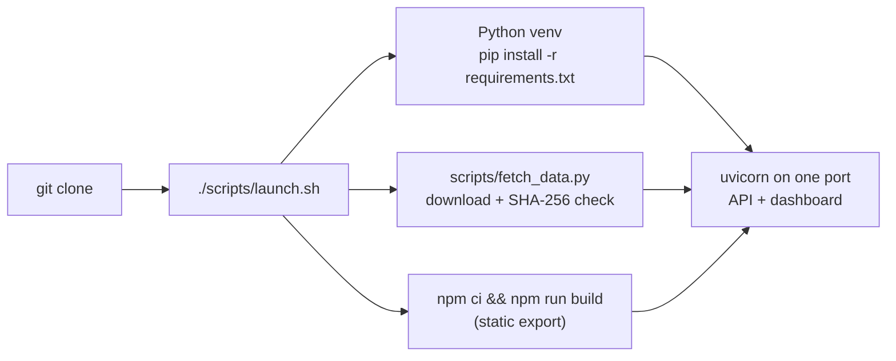
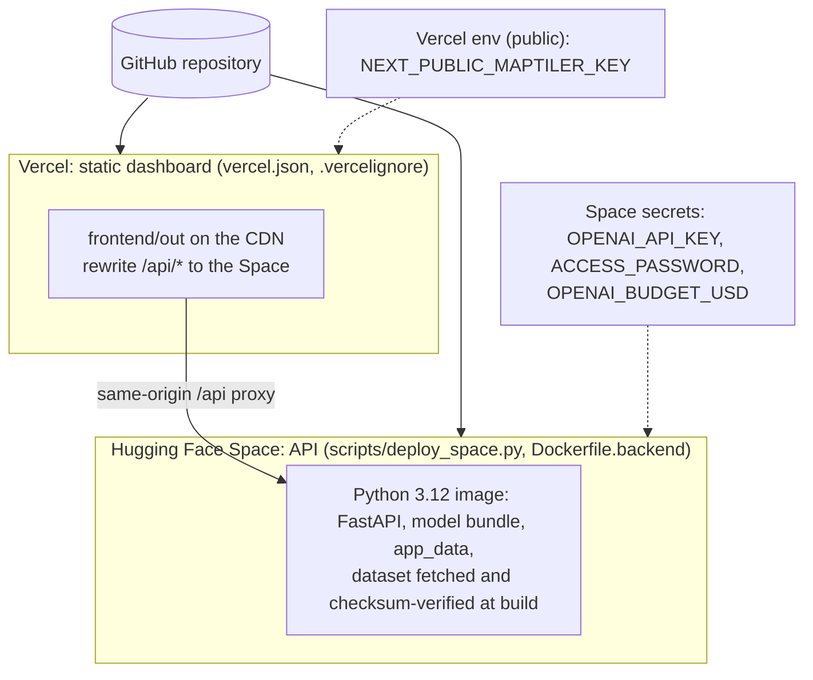
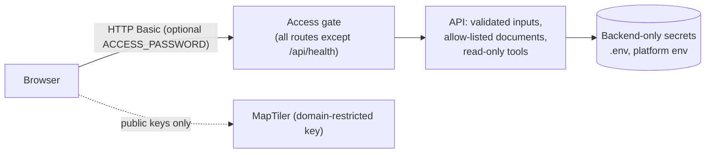
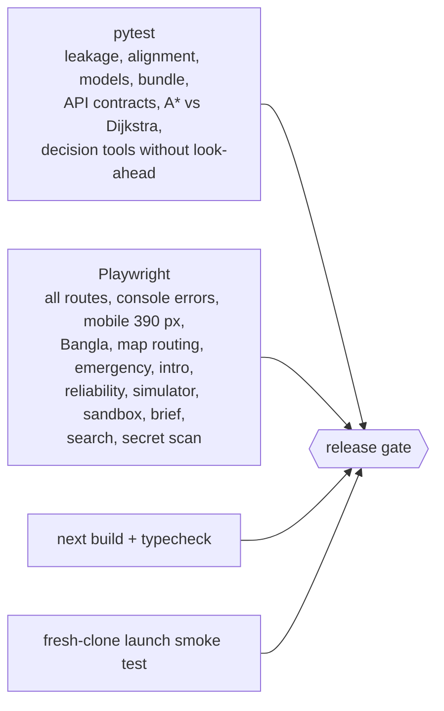

# Launch, deployment and security

[Architecture overview](../../ARCHITECTURE.md)

Steps: [`deployment.md`](../deployment.md)

## Local launch (judges)

An authenticated GitHub clone and cold-cache launch reached a healthy server in about 101 seconds with a verified 2016–2024 fixture already in place. See the [fresh-clone measurement](../../README.md#fresh-clone-measurement) for the setup and what the timing covers.

## Deployment targets

Single-container alternative: the root `Dockerfile` bundles dashboard and API (used for local or one-host runs).

## Security model

| Control | Where |
|---|---|
| Secrets never in git or the browser bundle | `.gitignore`, `.dockerignore`, `.vercelignore`; Playwright secret scan of served assets |
| Input validation | Pydantic types, regex patterns, bounded numbers (horizon 2-4, teams 1-60, simplify ≤ 0.01) |
| Injection-safe external queries | DGHS filter values quoted and validated; facility IDs pattern-checked |
| Bounded compute | routing snap ≤ 1 km, insight samples ≤ 2,500, DGHS ≤ 3,000 features, Copilot rate and budget limits |
| Data licences | OSM ODbL (`app_data/geo/LICENSE.md`), Open-Meteo CC BY 4.0, NASA POWER acknowledgement, MapTiler/OSM attribution on the map |
| Organizer data | not committed; fetched and checksum-verified; served only as derived views |

## Compute and API cost controls

| Resource | Control |
|---|---|
| Model inference | No GPU. ≈ 0.25 s for a cold 60-ward origin, ≈ 6 ms warm (LRU). Replay lookups ≈ 4 ms |
| Dashboard | Static export, no server rendering. Charts, map and 3D are code-split and loaded on demand; the 3D intro and Learn model fall back to SVG without WebGL or on low-end devices and are skipped or still under reduced motion. Command Center LCP 220 ms cold, 88 ms warm (local) |
| OpenAI | Backend only. `gpt-5.4-mini` answers, `text-embedding-3-small` (512 dims) retrieval index built once into `app_data/rag_index.npz` (≈ $0.0008 per rebuild). 900 output tokens, 30 requests/hour per client, input-size limit, USD budget guard (`OPENAI_BUDGET_USD`, default 1.00), 1 h response cache, usage log without content; ≈ $0.002-0.004 per answer. Without a key: retrieval-only |
| NASA POWER / Open-Meteo | Per-city queries, 15-40 s timeouts, memory + disk cache (history 24 h, current 10 min), stale fallback |
| Decision tools | Saved replay only: alert curve 15 ms, allocation 8 ms, season allocation 375 ms, cached per query |
| Routing | Local and free: graphs load in ≈ 0.3 s; A* median 6.5 ms (400/400 equal to Dijkstra). OSM is queried only by the offline build script; MapTiler geocoding runs from the browser only when the user searches places |
| DGHS GIS | 6 s connect timeout, 60 s circuit breaker, pagination capped at 3,000 features, 7-day cache with stale fallback |
| Deployment access | Optional shared password (`ACCESS_PASSWORD`, HTTP Basic); per-client Copilot rate limit works behind a proxy |
| Map tiles | MapTiler key in `frontend/.env.local`; without it the map uses a blank basemap and facilities, routes and directory still work |

If any external service fails, its panel shows a status message and every other page keeps working (`/api/integrations/status`).

## Testing

