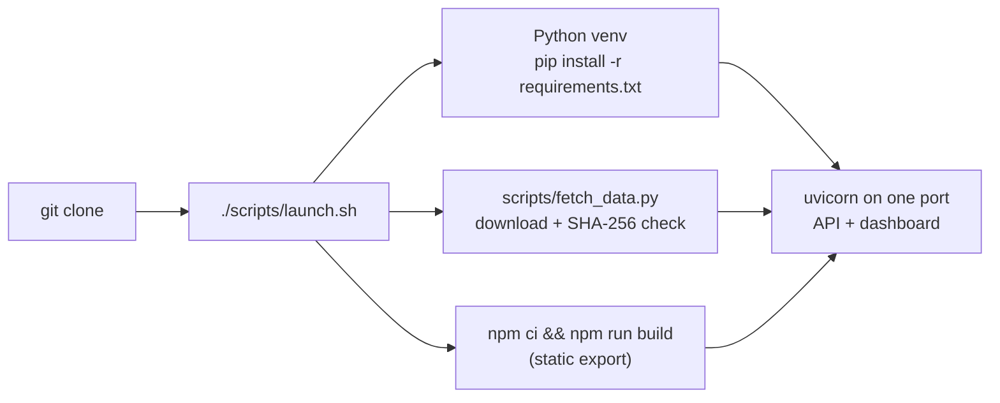
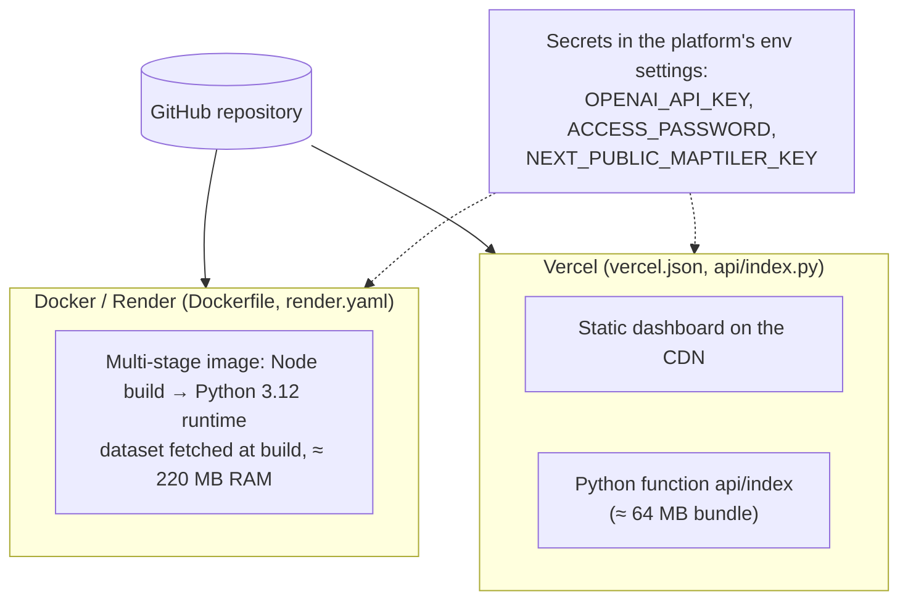
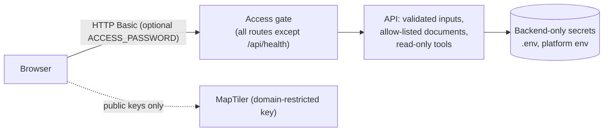

# Launch, deployment and security

[← Architecture overview](../../ARCHITECTURE.md) · Steps: [`deployment.md`](../deployment.md)

## Local launch (judges)

Measured: fresh clone to a healthy server in 59 s on the development Mac with warm pip and npm caches (a cold machine takes longer).

## Deployment targets

## Security model

| Control | Where |
|---|---|
| Secrets never in git or the browser bundle | `.gitignore`, `.dockerignore`, `.vercelignore`; Playwright secret scan of served assets |
| Input validation | Pydantic types, regex patterns, bounded numbers (horizon 2-4, teams 1-60, simplify ≤ 0.01) |
| Injection-safe external queries | DGHS filter values quoted and validated; facility IDs pattern-checked |
| Bounded compute | routing snap ≤ 1 km, insight samples ≤ 2,500, DGHS ≤ 3,000 features, Copilot rate and budget limits |
| Data licences | OSM ODbL (`app_data/geo/LICENSE.md`), Open-Meteo CC BY 4.0, NASA POWER acknowledgement, MapTiler/OSM attribution on the map |
| Organizer data | not committed; fetched and checksum-verified; served only as derived views |
