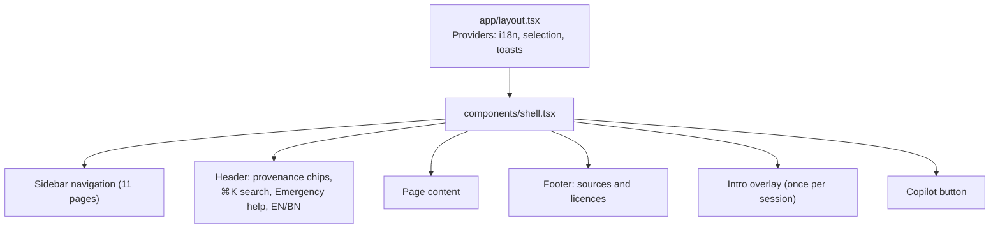
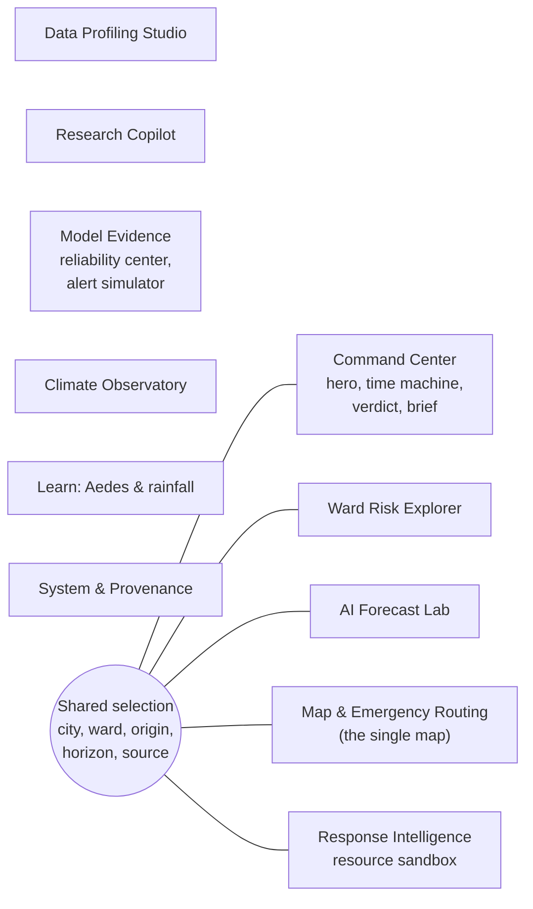
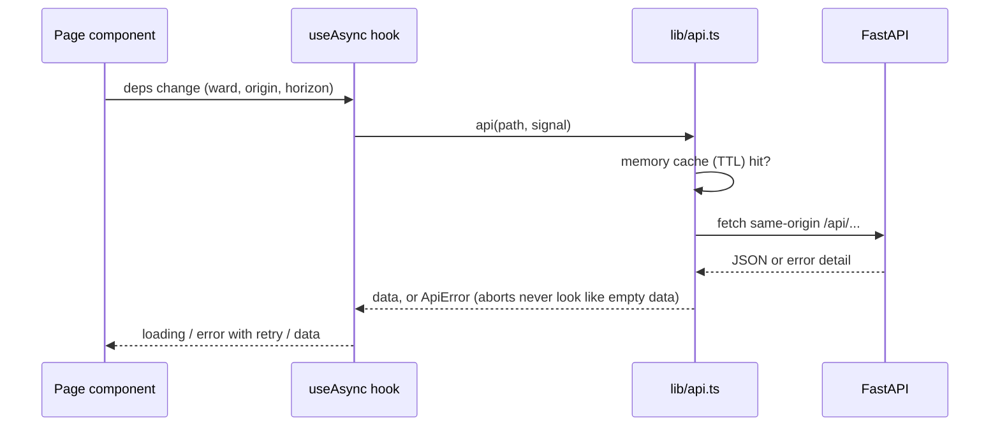

# Frontend: Next.js static dashboard

[Architecture overview](../../ARCHITECTURE.md)

Next.js 16 (static export), React 19, TypeScript, Tailwind 4, ECharts 6 (tree-shaken), MapLibre 6 with MapTiler, React Three Fiber (intro and Learn
page only), Motion. The build output `frontend/out` is served by FastAPI on the same origin, so there is no CORS and no server rendering.

## Application shell

## Pages

## Data access in the browser

## Cross-cutting rules

| Concern | Implementation |
|---|---|
| Bilingual | `lib/i18n.tsx` EN/BN dictionary, Bengali digits and dates, Noto Sans Bengali |
| Design system | tokens in `app/globals.css` (midnight navy, forest, teal, restrained cyan, ivory), atoms in `components/ui.tsx` |
| Charts | `components/echart.tsx` lazy ECharts, shared axis style, accessible labels |
| Performance | code-split map, charts and 3D; Command Center LCP 220 ms cold / 88 ms warm (local) |
| Accessibility | keyboard-reachable controls, ARIA roles on tabs, switches, dialogs; reduced-motion respected everywhere |
| Safety | Copilot Markdown sanitised; no secrets in the bundle (tested) |
