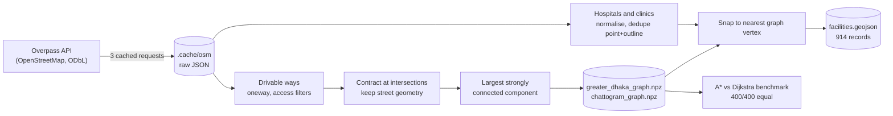
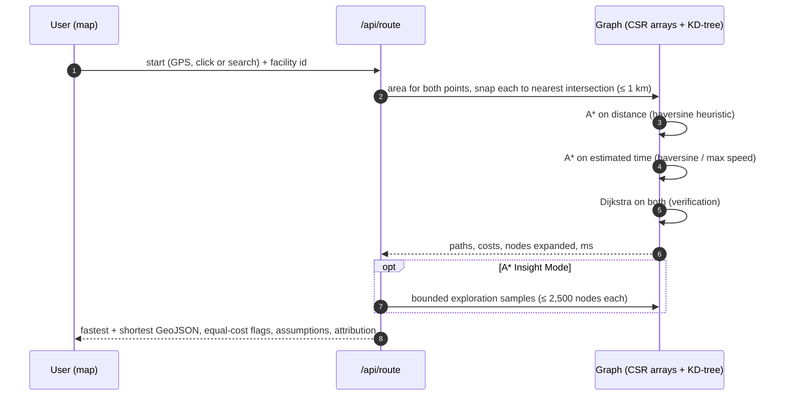
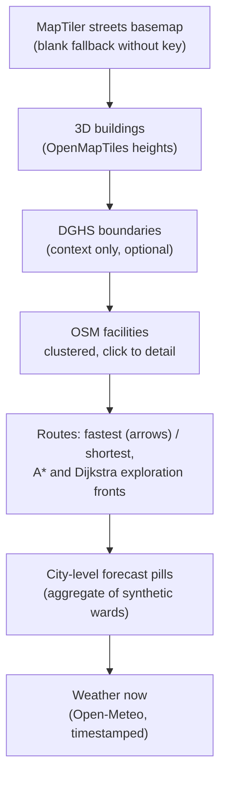
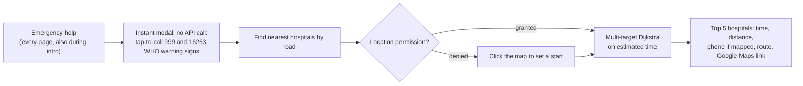

# Geospatial: facilities, road graphs, A* routing and emergency help

[Architecture overview](../../ARCHITECTURE.md)

Details: [`geospatial_routing.md`](../geospatial_routing.md), [`dghs_gis_integration.md`](../dghs_gis_integration.md)

## Build-time data pipeline

## Routing request

## Map composition (one map)

Synthetic ward forecasts are never attached to real geometry: the map shows them only as city aggregates, and the abstract ward-risk matrix sits beside the map.

## Emergency flow

No beds, admissions, doctors on duty or live traffic exist in these sources, and none are shown.
