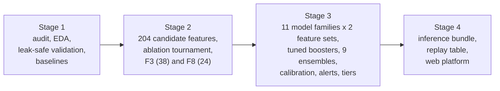
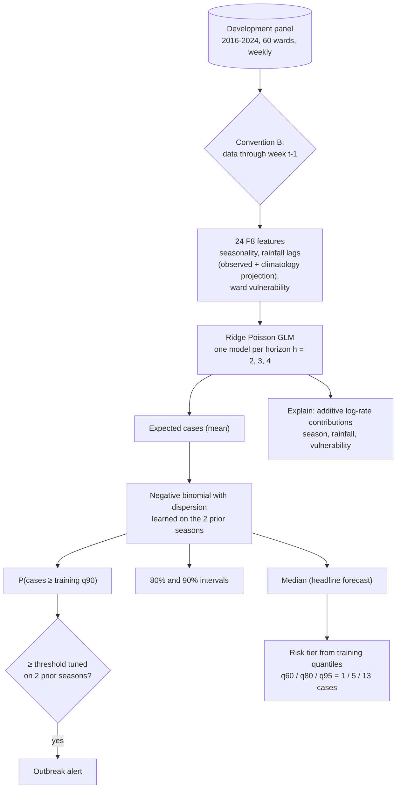
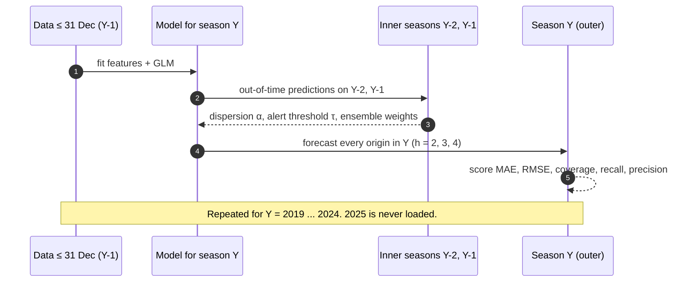
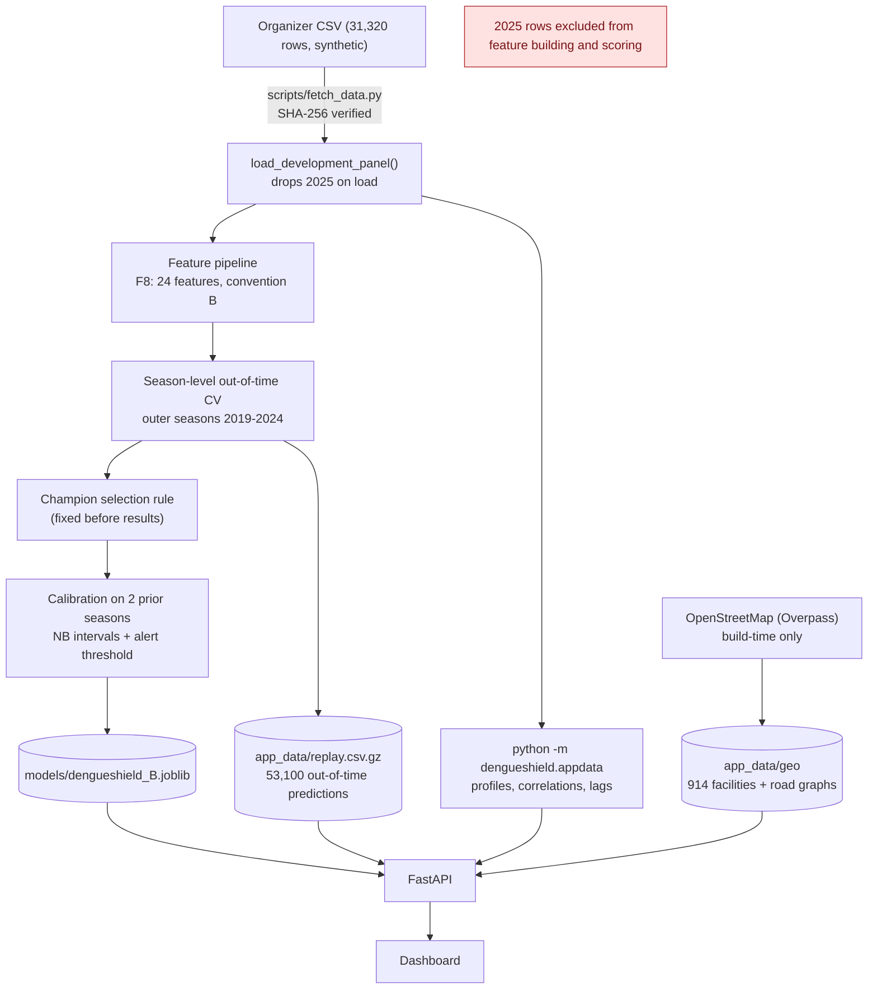
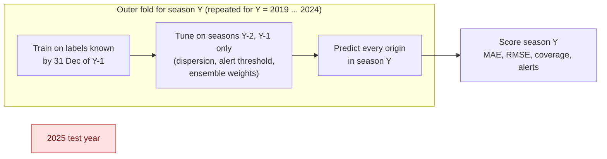

# ML pipeline: from raw data to a calibrated forecast bundle

[Architecture overview](../../ARCHITECTURE.md)

Details: [`model_selection.md`](../model_selection.md), [`calibration_and_uncertainty.md`](../calibration_and_uncertainty.md), [`validation_protocol.md`](../validation_protocol.md)

## Stages

## Forecast for one ward, origin and horizon

## Validation that every reported number comes from

## Artifacts

| Artifact | Produced by | Used by |
|---|---|---|
| `models/dengueshield_B.joblib` (primary), `_A.joblib` | Stage 3 notebooks | `/api/forecast*` live inference, `explain` |
| `app_data/replay.csv.gz` (53,100 rows) | `python -m dengueshield.appdata` from Stage 3 out-of-time predictions | Historical Replay, reliability center, alert simulator, resource sandbox |
| `reports/model_tournament/*.csv`, `app_data/validation.json` | notebooks 07-08 | Model Evidence |
| `app_data/{profile,distributions,correlations,seasonality,lag_analysis}.json` | `dengueshield.appdata` | Data Profiling Studio, Forecast Lab |

## Results (unchanged since Stage 3)

| Horizon | MAE 2022-24 | Coverage 80 / 90 (all weeks) | Coverage 80 / 90 (peaks) | Alert recall / precision (pooled replay) |
|---|---|---|---|---|
| 2 weeks | 1.107 | season means: 0.854 / 0.911 | season means: 0.607 / 0.740 | per horizon in the Reliability center |
| 3 weeks | 1.393 | | | 0.758 / 0.508 |
| 4 weeks | 1.512 | | | |

## Data flow

### Integrity boundaries

| Boundary | Rule |
|---|---|
| Organizer data vs real weather | NASA POWER / Open-Meteo are shown **beside** the synthetic data in the Climate Observatory; never a model input. |
| Live bundle vs Historical Replay | Replay = out-of-time predictions (2019-2024, nested calibration), used for every accuracy claim. Bundle values for origins ≤ 2024 are in-sample and labelled. |
| LLM vs numbers | The Copilot quotes only numbers returned by its read-only tools; it never computes forecasts. |
| Real facilities vs synthetic wards | Hospitals and roads are real OSM records; forecasts appear on the map only as city-level aggregates. No facility, route or polygon is linked to a synthetic ward ID. |
| Official boundaries vs dataset wards | DGHS polygons are context only; with no verified crosswalk, predictions use an abstract matrix. |
| Decision tools vs model | Reliability, alert-policy and allocation tools read saved replay rows only; nothing is refitted and the deployed alert rule is unchanged. |
| Frontend vs secrets | `OPENAI_API_KEY` stays in the backend `.env`; only public map keys are in `frontend/.env.local`. |

## Chronological validation

- **Origin convention B (primary):** a forecast issued at the start of week *t* uses weather and cases through week *t-1*; convention A is labelled "assumes week *t* is complete".
- **Hyperparameter search** ran on 2019-2021 only; 2022-2024 is the benchmark window.
- **Locked holdout:** 2025 is dropped on load, never displayed or scored (`docs/holdout_protocol.md`). The API refuses origins later than the last data week + 1.

## Why this model

Rule fixed before the tuned and ensemble results were seen (`docs/model_selection.md` §7): shortlist everything within 0.05 MAE of the best,
then take the simplest. Winner: **ridge Poisson GLM, 24 features, one model per horizon.**

| | |
|---|---|
| MAE 2022-24 (h = 2/3/4) | 1.107 / 1.393 / 1.512 |
| Cost | ~0.4 s to fit, sub-millisecond to predict, 11 KB bundle |
| Why not boosting/ensembles | Gaps to the best candidate were 0.002-0.037 MAE, inside the noise of 3-6 seasons; the GLM has the best high-incidence behaviour of the shortlist, the lowest variability and additive per-driver explanations |
| Intervals | Negative binomial, dispersion calibrated on the two prior seasons. 80% / 90% coverage 0.854 / 0.911 on average |
| Alert | P(cases ≥ training q90) ≥ tuned cut. Recall ≈ 0.78, precision ≈ 0.53 (season means; pooled 3-week replay 0.758 / 0.508) |
| Known weakness | Intervals under-cover outbreak peaks (0.607 at 80%, 0.740 at 90%) and peaks are under-predicted by ≈ 3 cases; shown in the UI |

Risk tiers (Low/Medium/High/Critical) are quantiles of the training data (1 / 5 / 13 weekly cases): **statistical categories, not official warning levels.**
