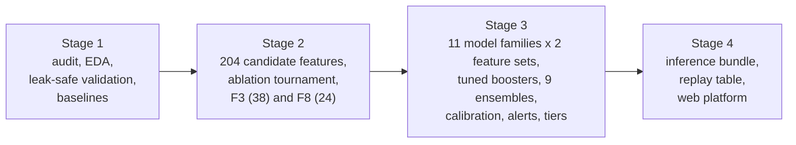
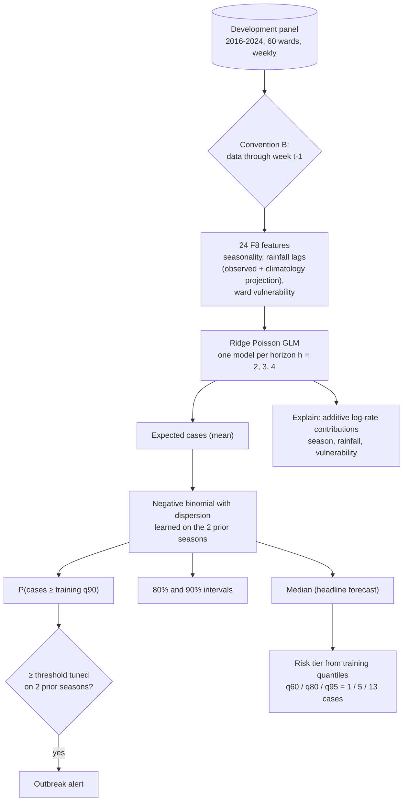
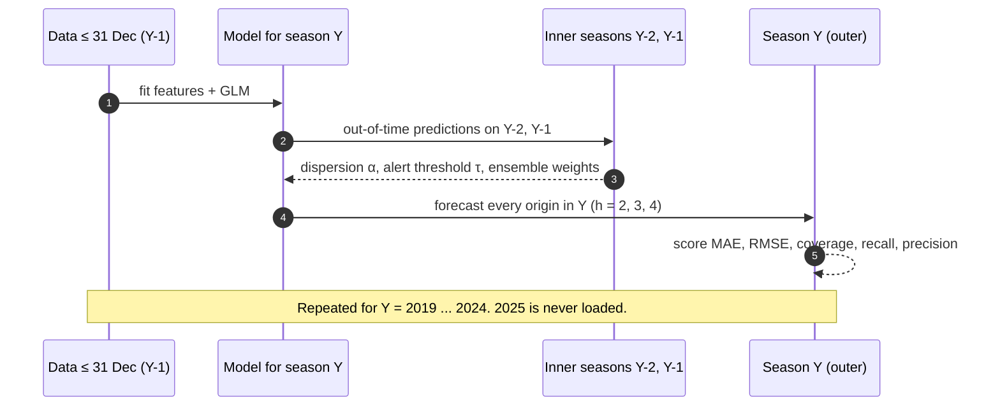

# ML pipeline: from raw data to a calibrated forecast bundle

[← Architecture overview](../../ARCHITECTURE.md) · Details: [`model_selection.md`](../model_selection.md), [`calibration_and_uncertainty.md`](../calibration_and_uncertainty.md), [`validation_protocol.md`](../validation_protocol.md)

## Stages

## Forecast for one ward, origin and horizon

## Validation that every reported number comes from

## Artifacts

| Artifact | Produced by | Used by |
|---|---|---|
| `models/dengueshield_B.joblib` (primary), `_A.joblib` | Stage 3 notebooks | `/api/forecast*` live inference, `explain` |
| `app_data/replay.csv.gz` (53,100 rows) | `python -m dengueshield.appdata` from Stage 3 out-of-time predictions | Historical Replay, reliability center, alert simulator, resource sandbox |
| `reports/model_tournament/*.csv`, `app_data/validation.json` | notebooks 07-08 | Model Evidence |
| `app_data/{profile,distributions,correlations,seasonality,lag_analysis}.json` | `dengueshield.appdata` | Data Profiling Studio, Forecast Lab |

## Results (unchanged since Stage 3)

| Horizon | MAE 2022-24 | Coverage 80 / 90 (all weeks) | Coverage 80 / 90 (peaks) | Alert recall / precision (pooled replay) |
|---|---|---|---|---|
| 2 weeks | 1.107 | season means: 0.854 / 0.911 | season means: 0.607 / 0.740 | per horizon in the Reliability center |
| 3 weeks | 1.393 | | | 0.758 / 0.508 |
| 4 weeks | 1.512 | | | |
