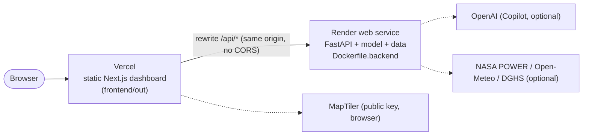

# Deployment: static dashboard on Vercel, API on Render

| Part | Where | Config | Secrets |
|---|---|---|---|
| Dashboard | Vercel project `dengueshield-ai` | `vercel.json` (build `frontend`, rewrite `/api/*` to the Render URL), `.vercelignore` (uploads only `frontend/`) | `NEXT_PUBLIC_MAPTILER_KEY`, `NEXT_PUBLIC_MAP_PROVIDER` (public, baked in at build) |
| API | Render web service `dengueshield-ai-api` | `render.yaml`, `Dockerfile.backend` (dataset fetched and SHA-256 verified at build) | `OPENAI_API_KEY`, `ACCESS_PASSWORD`, `OPENAI_BUDGET_USD` (set in Render, never in git) |

## Steps

1. **API (Render):** New + Blueprint from this repository (or create a Docker web service pointing at `Dockerfile.backend`), then set the three variables above. Health check: `/api/health`.
2. **Dashboard (Vercel):** set the destination host in `vercel.json` to your Render URL, then `vercel deploy --prod` from a clean checkout. Only `frontend/` is uploaded.
3. Open the Vercel URL. The first API call asks for the team password (HTTP Basic, any username) because the API is gated; `/api/health` stays open for health checks.

## Behaviour to know

- **Render free plan** sleeps after 15 minutes without traffic and needs about a minute to wake on the next request; the Starter plan (card required) stays on. Wake the service before a demo by opening `/api/health`.
- **Password:** the static dashboard pages are public but contain no data; every API response is behind `ACCESS_PASSWORD`. Rotate it by changing the Render variable.
- **Costs:** Copilot answers cost about US$0.003 each, limited to 30 per hour per client IP (`--proxy-headers` keeps the real client IP), 900 output tokens and an in-memory budget (`OPENAI_BUDGET_USD`, default 1.00, resets on restart). Set a hard monthly limit in the OpenAI dashboard as well.
- **MapTiler key** is visible in the browser by design; restrict it to your Vercel domain in the MapTiler dashboard.
- **Rebuilding the Copilot index:** if you change README/ARCHITECTURE/`docs/*.md`, run `python -m dengueshield.api.rag build` (about US$0.001) and commit `app_data/rag_index.npz`, otherwise the Copilot falls back to keyword-only retrieval.
- **Local test of the backend image:** `docker build -f Dockerfile.backend -t dengueshield-api . && docker run --rm -p 7860:7860 -e ACCESS_PASSWORD=test dengueshield-api`.
- **Single-container alternative:** `Dockerfile` builds the dashboard and API into one image (used by `./scripts/launch.sh` style local runs).
