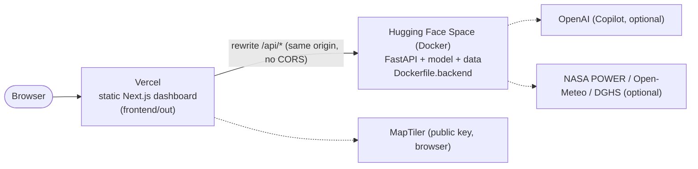

# Deployment: static dashboard on Vercel, API on Hugging Face Spaces

| Part | Where | Config | Secrets |
|---|---|---|---|
| Dashboard | Vercel project `dengueshield-ai` | `vercel.json` (build `frontend`, rewrite `/api/*` to the Hugging Face Space), `.vercelignore` (limits upload to the dashboard and its config) | `NEXT_PUBLIC_MAPTILER_KEY`, `NEXT_PUBLIC_MAP_PROVIDER` (public, baked in at build) |
| API | Hugging Face Space `AsifZaman1912/dengueshield-ai-api` (2 vCPU, 16 GB) | `scripts/deploy_space.py`, `Dockerfile.backend` (dataset fetched and SHA-256 verified at build) | `OPENAI_API_KEY`, `ACCESS_PASSWORD`, `OPENAI_BUDGET_USD` (Space secrets, never in git) |

## Steps

1. **API:** `python scripts/deploy_space.py <user>/<space>` (needs `hf auth login`) uploads the backend as one commit; set the three secrets in the Space settings. Health check: `/api/health`.
2. **Dashboard:** set the destination host in `vercel.json` to `https://<user>-<space>.hf.space`, then `vercel deploy --prod` from a folder containing only `frontend/` and `vercel.json`.
3. Open the Vercel URL. When `ACCESS_PASSWORD` is configured, API calls require HTTP Basic authentication with any username and that password. `/api/health` stays open.

Render is supported as an alternative (`render.yaml`), but its free plan (512 MB RAM, 0.1 CPU, sleeps after 15 minutes) made live inference take about 19 s, so it is not used.

## Behaviour to know

- **Hugging Face free Spaces** sleep after about 48 hours without traffic; open `/api/health` to wake one before a demo. The Space is public (a private Space cannot be reached through the Vercel proxy), so it exposes the backend source and derived data, never the dataset file or secrets.
- **Password:** the static dashboard is public. To restrict the API for a private preview, set or rotate `ACCESS_PASSWORD` in Space settings.
- **Costs:** Copilot answers cost about US$0.003 each, limited to 30 per hour per client IP (`--proxy-headers` keeps the real client IP), 900 output tokens and an in-memory budget (`OPENAI_BUDGET_USD`, default 1.00, resets on restart). Set a hard monthly limit in the OpenAI dashboard as well.
- **MapTiler key** is visible in the browser by design; restrict it to your Vercel domain in the MapTiler dashboard.
- **Rebuilding the Copilot index:** if you change README/ARCHITECTURE/`docs/*.md`, run `python -m dengueshield.api.rag build` (about US$0.001) and commit `app_data/rag_index.npz`, otherwise the Copilot falls back to keyword-only retrieval.
- **Local test of the backend image:** `docker build -f Dockerfile.backend -t dengueshield-api . && docker run --rm -p 7860:7860 -e ACCESS_PASSWORD=test dengueshield-api`.
- **Single-container alternative:** `Dockerfile` builds the dashboard and API into one image (used by `./scripts/launch.sh` style local runs).
